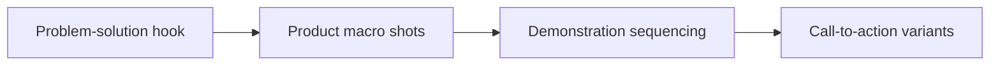

# UGC Creator Portfolio Shot List & Script Structure

A clear script gives every line a visual job. It gives every shot a reason to stay. **UGC Creator Portfolio Shot List & Script Structure** has one clear job. The practical goal is to build a credible UGC portfolio with product proof, clear demonstrations, and several brand-appropriate endings. This guide is built for UGC creators and brand teams. Set **problem-solution hook** alongside **product macro shots** before adding extra steps or decorative edits.

## Quick answer

Start with **Problem-solution hook**. Use **Product macro shots** to show the method clearly on camera in 4K at 60fps. Let **Demonstration sequencing** deliver the visual proof under locked 5600K light. Treat **Call-to-action variants** as your review gate. The core rule is simple: agree on the claim, evidence and approval route before the first take.

## Why Problem-solution hook and Product macro shots must agree

Revision rounds multiply when the brief leaves product truth, usage and proof open to interpretation. Here, the issue starts when **problem-solution hook** is planned without **product macro shots**. The draft may look good. Yet the creator still does not know what to film or approve.

Start with the smallest version of **problem-solution hook** that delivers fewer avoidable revisions. Check it against a brief-to-final-frame check. Keep this boundary in mind: Keep one feedback owner for each approval round. If proof is not ready, tighten the promise. Do not mask it with buzzwords.

## Decision map for UGC Creator Portfolio Shot List & Script Structure

| Decision | Evidence to prepare | Boundary |
| :--- | :--- | :--- |
| **Problem-solution hook** | Prepare a brief-to-final-frame check | Keep one feedback owner for each approval round. |
| **Product macro shots** | Prepare a clearly labelled comparison | Do not improvise a product claim on set. |
| **Demonstration sequencing** | Prepare an approved product detail | Do not improvise a product claim on set. |
| **Call-to-action variants** | Prepare a brief-to-final-frame check | Keep one feedback owner for each approval round. |

## How to put the method into practice

### 1. Problem-solution hook

Open problem-solution hook in the first 0-3s with the visual result before any setup. Pair the spoken line with clear 4K 60fps action. Keep it aligned with **product macro shots**.

Verify this step with a brief-to-final-frame check. Keep one feedback owner for each approval round. Look for fewer avoidable revisions. If that outcome is missing, adjust **problem-solution hook** before filming **product macro shots**.

### 2. Product macro shots

Set up product macro shots with a fixed 50mm or 85mm macro lens. Keep camera distance locked at 3 to 4 feet across takes. Keep it aligned with **demonstration sequencing**.

Verify this step with a clearly labelled comparison. Do not improvise a product claim on set. Look for fewer avoidable revisions. If that outcome is missing, adjust **product macro shots** before filming **demonstration sequencing**.

### 3. Demonstration sequencing

Build demonstration sequencing around visible proof. Show the before-and-after test under identical light with zero filter trickery. Keep it aligned with **call-to-action variants**.

Verify this step with an approved product detail. Do not improvise a product claim on set. Look for clearer approvals. If that outcome is missing, adjust **demonstration sequencing** before filming **call-to-action variants**.

### 4. Call-to-action variants

Make call-to-action variants a direct prompt: ask for one specific action or keyword response in the final 5s of the video. Keep it aligned with **problem-solution hook**.

Verify this step with a brief-to-final-frame check. Keep one feedback owner for each approval round. Look for usable hook variations. If that outcome is missing, adjust **call-to-action variants** before filming **problem-solution hook**.

## A script you can adapt

Use this 30-second script structure for **UGC Creator Portfolio Shot List & Script Structure**:

- **Opening shot (0-3s):** `[Visual friction visible under 5600K light]`
- **Spoken hook (0-3s):** "If you struggle with `[exact problem]`, watch this step."
- **Method beats (3-15s):** `Problem-solution hook followed by Product macro shots`
- **Proof beat (15-25s):** `an approved product detail`
- **Call to action (25-30s):** "Save this card before your next shoot."

Read the lines for **Problem-solution hook** in **UGC Creator Portfolio Shot List & Script Structure** aloud. Trim any sentence that takes more than 4 seconds to say on camera.

## A practical first pass

Suppose UGC creators and brand teams must complete one short video script in a short 45-minute window. First, they lock **problem-solution hook**. They prepare a clearly labelled comparison. Then they use **demonstration sequencing** to keep the promise visible on camera in 4K at 60fps. Do not improvise a product claim on set. During review, they judge **call-to-action variants** against usable hook variations. A vague request for more polish is rejected.

## Review Call-to-action variants before the next pass

- **Direction:** Does problem-solution hook name one clear choice?
- **Visibility:** Can the viewer see product macro shots without reading the caption?
- **Proof:** Does an approved product detail back up the main claim under 5600K light?
- **Boundary:** Has the creator respected this guardrail: Keep one feedback owner for each approval round.
- **Learning:** Will the next pass improve based on clearer approvals?

## Frequently asked questions

### What must Problem-solution hook decide first?

Set one clear default for **problem-solution hook** next to **product macro shots**. State the exact condition that justifies a change. A brief-to-final-frame check is far more useful than a long reference deck because you can test it directly on set.

### How can Product macro shots be tested with simple gear?

Protect the proof moment above all else. Cut optional shots first. A short version works well when **product macro shots** stays visible and claims stay inside your approved boundary.

### When should Call-to-action variants be updated?

Update **call-to-action variants** when repeated passes on **demonstration sequencing** show the same friction. A shift in audience, offer, or weekly capacity also justifies an update. A single slow video is not a reason to rebuild your whole system.

### How long should this workflow take for UGC Creator Portfolio Shot List & Script Structure?

Aim for 45 minutes total production for **UGC Creator Portfolio Shot List & Script Structure**. Spend 15 minutes setting up your mic and camera, film 3 takes, and confirm a brief-to-final-frame check before tearing down.

## Next step

Use **problem-solution hook** and **demonstration sequencing** as the only two must-haves on the next card. For a packed brief, [go to the store](/store).
