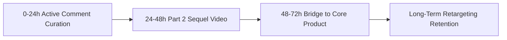

# The Viral Aftermath: What to Post in the 72 Hours After a Breakout Video

Going viral is often treated as the ultimate finish line of content creation. But in professional creative direction, a viral breakout is merely the opening whistle. The 72-hour window immediately following a breakout video is the most critical inflection point for your channel's long-term trajectory.

If you disappear for a week or pivot to an aggressive pitch, new viewers will leave as fast as they arrived. The algorithm will then drop your future posts back to baseline reach.

This guide provides a 72-hour roadmap to capture momentum, build trust with new viewers, and convert viral reach into loyal followers.

## Quick answer

Follow three rules during the 72 hours after a video breaks out.
1. **Publish Part Two Quickly:** Share a deeper breakdown within 36 hours while algorithms actively index your profile.
2. **Engage with Authority:** Pin a high-value comment answering the top objection.
3. **Build a Natural Bridge:** Connect the viral topic to your core guides without sounding pushy.



## The 72-Hour Viral Capitalization Timeline

```text
HOUR 0 - 24 ──► Active Moderation & Pinned Objection Answer (Cementing Trust)
HOUR 24 - 48 ──► Publish "The Counter-Intuitive Part 2" (Riding Algorithmic Affinity)
HOUR 48 - 72 ──► Deploy the Bridge Asset to Creator Vault / Resource Guide (Capturing Value)
```

### Hours 0 to 24: Active Comment Curation and the Pinned Anchor
When a video surges past 50,000 views, the comment section becomes a goldmine of audience psychology. Scan the comments for the single most common objection or misgrasp. Write a detailed, respectful 3-sentence answer and pin it to the top. This immediately establishes high intellectual status and converts casual scrollers into admirers.

### Hours 24 to 48: The Sequel / Part 2 Video
Platforms give accounts with breakout momentum a reach boost on their next post. If you publish a sequel within 48 hours, the system serves that video to people who engaged with the first.

### Hours 48 to 72: The Bridge to Your Owned system
Attention on social media is rented; your goal is to convert rented attention into owned relationships. Introduce your complete resource guide, template brief, or Creator Vault package as the natural next step for viewers who want the full action system.

---

## What to Post vs. What to Avoid in the 72-Hour Window

| Action. | Dangerous Mistake (Momentum Killer). | High-Impact Strategic Move (Growth Multiplier). |
| :--- | :--- | :--- |
| **Next Video Topic**. | Completely unrelated personal vlog or niche switch. | Direct tactical sequel or "What happened next" breakdown. |
| **Comment Handling**. | Ignoring comments or arguing with trolls. | Pinning high-value clarifications and thanking thoughtful contributors. |
| **Profile Grid**. | Outdated links or mismatched pinned posts. | Updating top 3 pinned posts to complement the viral topic. |
| **Commercial Framing**. | Aggressive hard-sell discount pop-ups. | Organic invitation to explore the structured creative brief library. |

---

## Step-by-Step 72-Hour Production Execution

### Step 1: Film the "Sequel Brief" on Day 2
Take the top debated question from your comments. Use it as your hook: in my last video, viewers asked how to apply this rule, so here is the breakdown.

### Step 2: Update Your Bio Link and Creator Vault Pathways
Ensure your bio link leads directly to the specific template discussed in the video rather than a generic homepage.

### Step 3: Publish an Instagram Story Behind-the-Scenes Deep Dive
Share your analytics in Stories and explain why the video worked. This builds a deeper connection with your core audience.

---

## Fill-in-the-Blank "Part 2" Hook Formula

```text
[Hook]: "My last video on [viral topic] got over [view count] views. But the most important question in the comments was: '[Exact quote of top comment]'."
+ [Immediate Mechanism]: "Here is the step-by-step answer that I didn't have time to include in the 30-second version."
+ [Proof / proof]: Show the full spreadsheet. Brief, or workflow.
+ [Next Action]: "Check the link in my bio to access the complete shoot-ready template."
```

---

## Frequently Asked Questions

### What if the viral video brought in angry comments or trolls?
Viral reach exposes your work to broader audiences. Do not take negative remarks personally. Filter out abusive words, pin one calm clarification, and let loyal fans defend your perspective.

### Will my next video get the same number of views?
Usually not. A follow-up video earns a fraction of the viral peak. But its conversion rate will be much higher because it speaks to a qualified, high-intent audience.
