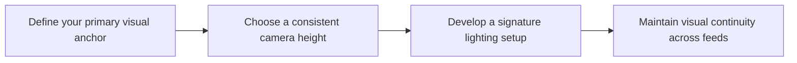

# Visual Signature Guide for Instagram Creators

A plan becomes useful when you can film without rethinking the strategy each time. **Visual Signature Guide for Instagram Creators** has one clear job. The practical goal is to establish a distinct color grade, camera perspective, and production identity. This guide is built for creators building a recognisable visual identity. Set **define your primary visual anchor** alongside **choose a consistent camera height** before adding extra steps or decorative edits.

## Quick answer

Start with **Define your primary visual anchor**. Use **Choose a consistent camera height** to show the method clearly on camera in 4K at 60fps. Let **Develop a signature lighting setup** deliver the visual proof under locked 5600K light. Treat **Maintain visual continuity across feeds** as your review gate. The core rule is simple: set a small number of visual defaults, test them across formats and change one variable at a time.

## Build the minimum workable version

A feed feels inconsistent when camera height, light, crop and props change before any pattern has time to register. Here, the issue starts when **define your primary visual anchor** is planned without **choose a consistent camera height**. The draft may look good. Yet the creator still does not know what to film or approve.

Start with the smallest version of **define your primary visual anchor** that delivers less format-to-format drift. Check it against a nine-post continuity check. Keep this boundary in mind: Test the crop on feed, Stories and Reels covers. If proof is not ready, tighten the promise. Do not mask it with buzzwords.

## Decision map for Visual Signature Guide for Instagram Creators

| Decision | Evidence to prepare | Boundary |
| :--- | :--- | :--- |
| **Define your primary visual anchor** | Prepare a nine-post continuity check | Test the crop on feed, Stories and Reels covers. |
| **Choose a consistent camera height** | Prepare a nine-post continuity check | Do not mistake a preset for a complete visual system. |
| **Develop a signature lighting setup** | Prepare a labelled lighting reference | Grade for truthful skin and product colour first. |
| **Maintain visual continuity across feeds** | Prepare a controlled before-and-after grade | Grade for truthful skin and product colour first. |

## How to put the method into practice

### 1. Define your primary visual anchor

Treat define your primary visual anchor as a direct operational step. Make it support **choose a consistent camera height** and follow this rule: set a small number of visual defaults, test them across formats and change one variable at a time.

Verify this step with a nine-post continuity check. Test the crop on feed, Stories and Reels covers. Look for less format-to-format drift. If that outcome is missing, adjust **define your primary visual anchor** before filming **choose a consistent camera height**.

### 2. Choose a consistent camera height

Set up choose a consistent camera height with a fixed 50mm or 85mm macro lens. Keep camera distance locked at 3 to 4 feet across takes. Keep it aligned with **develop a signature lighting setup**.

Verify this step with a nine-post continuity check. Do not mistake a preset for a complete visual system. Look for faster production decisions. If that outcome is missing, adjust **choose a consistent camera height** before filming **develop a signature lighting setup**.

### 3. Develop a signature lighting setup

Set develop a signature lighting setup under a locked 5600K diffused key light. Lock manual exposure at 100% before take one to stop flicker. Keep it aligned with **maintain visual continuity across feeds**.

Verify this step with a labelled lighting reference. Grade for truthful skin and product colour first. Look for stronger visual recognition. If that outcome is missing, adjust **develop a signature lighting setup** before filming **maintain visual continuity across feeds**.

### 4. Maintain visual continuity across feeds

Use maintain visual continuity across feeds to set a clear boundary for **define your primary visual anchor**. Name what counts as done and what needs a retake.

Verify this step with a controlled before-and-after grade. Grade for truthful skin and product colour first. Look for stronger visual recognition. If that outcome is missing, adjust **maintain visual continuity across feeds** before filming **define your primary visual anchor**.

## A script you can adapt

Use this shoot card for **Visual Signature Guide for Instagram Creators**:

- **Audience job:** `[The exact moment this post helps the viewer]`
- **Promise:** `[One clear outcome delivered in 30 seconds]`
- **Workflow:** `Define your primary visual anchor → Choose a consistent camera height → Develop a signature lighting setup`
- **Proof:** `a labelled lighting reference`
- **Capacity rule:** `[Cap weekly filming to a single 45-minute block]`
- **Call to action:** `[One clear save or reply prompt]`

Finish **Define your primary visual anchor** and **Choose a consistent camera height** for **Visual Signature Guide for Instagram Creators** before adding extra format variations.

## A practical first pass

Suppose creators building a recognisable visual identity must complete one finished content cycle in a short 45-minute window. First, they lock **define your primary visual anchor**. They prepare a nine-post continuity check. Then they use **develop a signature lighting setup** to keep the promise visible on camera in 4K at 60fps. Grade for truthful skin and product colour first. During review, they judge **maintain visual continuity across feeds** against stronger visual recognition. A vague request for more polish is rejected.

## Review Maintain visual continuity across feeds before the next pass

- **Direction:** Does define your primary visual anchor name one clear choice?
- **Visibility:** Can the viewer see choose a consistent camera height without reading the caption?
- **Proof:** Does a labelled lighting reference back up the main claim under 5600K light?
- **Boundary:** Has the creator respected this guardrail: Grade for truthful skin and product colour first.
- **Learning:** Will the next pass improve based on stronger visual recognition?

## Frequently asked questions

### What must Define your primary visual anchor decide first?

Set one clear default for **define your primary visual anchor** next to **choose a consistent camera height**. State the exact condition that justifies a change. A nine-post continuity check is far more useful than a long reference deck because you can test it directly on set.

### How can Choose a consistent camera height be tested with simple gear?

Protect the proof moment above all else. Cut optional shots first. A short version works well when **choose a consistent camera height** stays visible and claims stay inside your approved boundary.

### When should Maintain visual continuity across feeds be updated?

Update **maintain visual continuity across feeds** when repeated passes on **develop a signature lighting setup** show the same friction. A shift in audience, offer, or weekly capacity also justifies an update. A single slow video is not a reason to rebuild your whole system.

### How long should this workflow take for Visual Signature Guide for Instagram Creators?

Keep the shoot for **Visual Signature Guide for Instagram Creators** within a 45-minute filming block. Set up lighting in 10 minutes, film 3 takes of **choose a consistent camera height** in 4K at 60fps, and lock your primary cut.

## Next step

Before the first take, settle **define your primary visual anchor** and **develop a signature lighting setup**. If the crew still asks the same questions, [open the store](/store).
