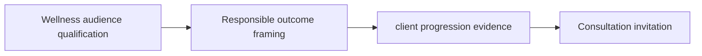

# Wellness & Fitness Reels for Premium Services

A practical workflow cuts context switching before it tries to add more volume. **Wellness & Fitness Reels for Premium Services** has one clear job. The goal is to help prospective clients assess fit. Use responsible outcome framing, client progression proof, and a clear consultation prompt. This guide is built for coaches and fitness creators. Set qualification rules before adding extra steps or decorative edits.

## Quick answer

Start with **Wellness audience qualification**. Use **Responsible outcome framing** to show the method clearly on camera in 4K at 60fps. Let **client progression evidence** deliver the visual proof under locked 5600K light. Treat **Consultation invitation** as your review gate. The core rule is simple: teach one cue at a time, show the relevant angle and keep outcome language responsible.

## Build the minimum workable version

A single flattering angle can hide the movement detail that viewers actually need to understand. Here, the issue starts when **wellness audience qualification** is planned without **responsible outcome framing**. The draft may look good. Yet the creator still does not know what to film or approve.

Start with the smallest version of **wellness audience qualification** that delivers better technique questions. Check it against a repeatable progression step. Keep this boundary in mind: Avoid guaranteed body or income outcomes. If proof is not ready, tighten the promise. Do not mask it with buzzwords.

## Decision map for Wellness & Fitness Reels for Premium Services

| Decision. | Evidence to prepare. | Boundary. |
| :--- | :--- | :--- |
| **Wellness audience qualification**. | Prepare a repeatable progression step. | Avoid guaranteed body or income outcomes. |
| **Responsible outcome framing**. | Prepare a slowed technique comparison. | Show the common error before the correction. |
| **client progression evidence**. | Prepare a repeatable progression step. | Show the common error before the correction. |
| **Consultation invitation**. | Prepare a slowed technique comparison. | State when a movement needs individual assessment. |

## How to put the method into practice

### 1. Wellness audience qualification

Focus audience vetting on one specific problem. Share one clear fix without exaggerated claims. Align this step with your visual proof.

Verify this step with a real progression drill. Avoid false body or health promises. Watch for sharper technique questions in comments. If that feedback is missing, adjust your angle before you film.

### 2. Responsible outcome framing

Make outcome framing easy to verify on set. Confirm your proof before shooting the client example.

Test this step with a slowed technique clip. Show the common fault before the fix. Look for genuine client inquiries. If questions stay vague, sharpen your visual cue before filming.

### 3. client progression evidence

Build client proof around visible facts. Show side-by-side clips under matching light with zero filter tricks. Align this proof with your call to action.

Confirm this step with a clean form comparison. Highlight the common mistake before the proper fix. If viewer questions stay surface-level, refine the clip before moving to the consult prompt.

### 4. Consultation invitation

Use your consultation offer to set clear client expectations. Define who is ready for private coaching and who should stick to basic drills.

Test this step with a calm closing prompt. State when a movement requires personal screening. If inquiries are not qualified, refine the call to action before the next shoot.

## A script you can adapt

Use this shoot card for **Wellness & Fitness Reels for Premium Services**:

- **Audience job:** `[The exact moment this post helps the viewer]`
- **Promise:** `[One clear outcome delivered in 30 seconds]`
- **Workflow:** `Wellness audience qualification → Responsible outcome framing → client progression evidence`
- **Proof:** `a repeatable progression step`
- **Capacity rule:** `[Cap weekly filming to a single 45-minute block]`
- **Call to action:** `[One clear save or reply prompt]`

Finish **Wellness audience qualification** and **Responsible outcome framing** for **Wellness & Fitness Reels for Premium Services** before adding extra format variations.

## A practical first pass

Suppose coaches and fitness creators must finish a video in a 45-minute window. First, they lock the audience check. They prepare a slowed technique comparison. Then they use visual proof to keep the promise clear on camera. They show the common error before the fix. During review, they judge the call to action against clear lesson formats. Vague requests for extra polish are rejected.

## Review Consultation invitation before the next pass

- **Direction:** Does wellness audience qualification name one clear choice?
- **Visibility:** Can the viewer see responsible outcome framing without reading the caption?
- **Proof:** Does a repeatable progression step back up the main claim under 5600K light?
- **Boundary:** Has the creator respected this guardrail: State when a movement needs individual assessment?
- **Learning:** Will the next pass improve based on better technique questions?

## Frequently asked questions

### What must Wellness audience qualification decide first?

Set one clear default for your audience check alongside responsible framing. State the exact trigger for any change. A quick progression step beats a long reference deck because you can test it directly on set.

### How can Responsible outcome framing be tested with simple gear?

Protect the proof moment above all else. Cut optional shots first. A short version works well when **responsible outcome framing** stays visible and claims stay inside your approved boundary.

### When should Consultation invitation be updated?

Update **consultation invitation** when repeated passes on **client progression evidence** show the same friction. A shift in audience, offer, or weekly capacity also justifies an update. A single slow video is not a reason to rebuild your whole system.

### How long should this workflow take for Wellness & Fitness Reels for Premium Services?

Aim for 45 minutes total production for **Wellness & Fitness Reels for Premium Services**. Spend 15 minutes setting up your mic and camera, film 3 takes, and confirm a repeatable progression step before tearing down.

## Next step

Keep **wellness audience qualification** and **client progression evidence** on a page you can hold. If that is still too loose, [compare brief packages](/store).
