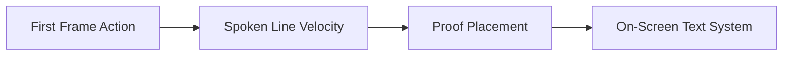

# Why Your Reels Get Stuck at 200 Views: A Creative Audit for Independent Creators

When an Instagram Reel stalls between 150 and 250 views. Most creators immediately blame the algorithm, suspect an invisible shadowban. Or assume their account is dead. In reality, the 200-view ceiling is not a platform penalty—it is the initial distribution test cohort. Every short-form video platform pushes newly published content to a small test audience of 100 to 300 users. If that initial group swipes away within the first 1.5 seconds or fails to watch past the midpoint. The distribution engine stops expanding reach to non-followers.

This guide provides a clinical creative audit to diagnose exactly why your Reels stall in the test cohort and how to engineer the visual and spoken variables you can actually control on shoot day.

## Quick answer

Your Reel is stuck at 200 views because the initial test cohort experienced a sub-second drop-off. To break through the 200-view ceiling on your next shoot:
1. **Eliminate introductory filler:** Never start with "Hey guys," "So today," or long throat-clearing pauses.
2. **Execute a physical action at 0.5s:** Move an object. Adjust the camera proximity, or show the end outcome before speaking.
3. **Fulfill the hook's promise in beat one:** Show immediate visual proof or tension within 0:01–0:03 rather than delaying the reveal to the end of the video.



## The 3 Failure Points That Trigger the 200-View Distribution Stall

```text
TEST COHORT (0-200 Views) ──┬── [Failure 1: 0.0s-0.8s] Scroll Momentum Not Broken (Swipe Away)
                            ├── [Failure 2: 1.0s-3.0s] Abstract Promise Without Visual Proof
                            └── [Failure 3: 4.0s-12.0s] Monotonous Visual Rhythm (Viewer Fatigue)
```

### 1. Scroll Inertia Deficit (0.0s – 0.8s)
The human thumb swipes through short-form feeds in about 400 to 700 milliseconds. If the first frame of your video is a static talking head staring blankly at the lens or an abstract graphic with tiny text. The viewer's scrolling inertia carries them past your video before audio registers. You need a physical or visual pattern interrupt (e.g.. Eye-level lens approach, physical object movement, high-contrast framing) to force the thumb to halt.

### 2. Delayed Proof & Cognitive Mismatch (1.0s – 3.0s)
The most common mistake among expert and lifestyle creators is making a bold verbal claim in the hook while showing unrelated background B-roll or waiting until the final 5 seconds to deliver the answer. When viewers detect a clickbait gap between what was promised and what is being shown. Retention plummets below the 40% threshold required for non-follower algorithmic expansion.

### 3. Visual Rhythm Monotony (4.0s – 15.0s)
Holding a single camera angle for more than 4 seconds without an edit cut. B-roll insert, focal length punch-in, or on-screen text transition induces visual fatigue. The brain adapts quickly to static visual feeds. Introducing purposeful cutaways resets viewer attention.

---

## The 200-View Creative Diagnostic Matrix

| Diagnostic Check | Warning Signal on Set | Exact Creative Fix |
| :--- | :--- | :--- |
| **First Frame Action** | Creator standing still waiting to speak | Start the clip mid-action (e.g., placing notebook, pulling lens focus, walking into frame). |
| **Spoken Line Velocity** | Hook exceeds 16 words or takes > 3.5s to deliver | Compress the hook into 6–12 sharp words with clear emotional or cognitive tension. |
| **Proof Placement** | Proof revealed only at the end of the video | Show a 1-second preview of the result or proof document at 0:02. |
| **On-Screen Text System** | Text covers center of screen or duplicates spoken dialogue exactly | Position restrained 3-word keyword overlays in the upper third safe zone. |
| **Audio Ducking & Clarity** | Background music volume drowns spoken frequencies | Duck music track by -14dB to -18dB whenever speech is active. |

---

## Step-by-Step Implementation for Your Next Shoot

### Step 1: Strip the First 2 Seconds of Recorded Footage
When editing your raw take, look at your timeline waveform. Locate the exact millisecond where your vocal cord produces the first syllable or your hands initiate physical movement. Slice away everything before that timestamp. Beginning on active movement instantly improves first-second retention.

### Step 2: Establish the Reverse-Expectation Hook
Instead of stating common knowledge ("Drinking water is good for your skin"). Introduce a cognitive dissonance gap: *"The biggest mistake creators make with hydration is drinking it all before 9 AM."* This triggers the Anterior Cingulate Cortex (ACC) in the viewer's brain. Forcing them to pause and resolve the conflict.

### Step 3: Insert the Proof Bridge at 0:03
Immediately following the hook sentence, insert a 1.2-second cutaway of the tangible artifact. Document, transformation result, or screen verification. This proves to the viewer that this video will deliver on its promise.

---

## Fill-in-the-Blank Script Formula

Use this exact shoot formula to engineer a high-retention 30-second Reel:

- **[0:00 - 0:02] Frame 1 Physical Hook:** `[Physical action: holding up specific artifact/result to camera]` + *"If your [specific goal/activity] feels stuck at [pain metric]. You are probably making this one mistake."*
- **[0:02 - 0:06] Proof Bridge:** `[B-roll cutaway showing data. Texture, or concrete proof]` + *"Here is what [benchmark data/expert result] actually looks like when done correctly."*
- **[0:06 - 0:20] The 2-Step Mechanism:** `[Medium shot with clear focal punch-in]` + *"Step one: Replace [common wrong habit] with [exact tactical adjustment]. Step two: Set your [specific boundary/parameter]."*
- **[0:20 - 0:28] Payoff & Decision CTA:** *"Save this shot list before your next shoot. And test this opening sequence on your next 3 videos."*

---

## Frequently Asked Questions

### Does posting more frequently help break the 200-view ceiling?
No. Publishing 3 low-retention videos per day simply produces three stalled 200-view data points while accelerating creator burnout. Improving the first 2 seconds of one well-crafted. Pre-decided brief will generate more non-follower distribution than a dozen rushed uploads.

### How do I know if my drop-off is audio or visual?
Check your Instagram Insights retention graph. A steep cliff in the first 0.5 to 1.0 second indicates a visual packaging failure (scroll inertia wasn't broken). A drop-off between 2.0 and 4.0 seconds indicates an audio/hook mismatch (the spoken line was boring. Vague, or failed to deliver immediate tension).

### What camera proximity works best for talking head Reels?
Eye-level medium-close up (chest to top of head) shot at a 50mm to 85mm equivalent focal length establishes parasocial intimacy and mirror neuron activation without distorting facial features.
