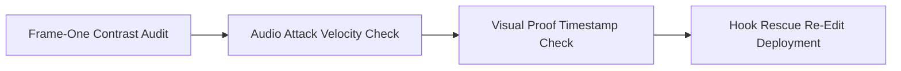

# Why Two Similar Videos Perform Completely Differently: The Creative Distribution Audit

Every creator knows the frustration of posting two similar videos with wildly different results. One stalls at 400 views while the other surges to 250,000. When this happens, creators often assume the algorithm is random or unfair.

In reality, platform distribution follows clear rules. Tiny differences in the first 800 milliseconds, subtle shifts in pacing, and topic resonance alter how early viewers react.

This guide provides a step-by-step audit to explain why similar videos diverge and how to stabilize your reach.

## Quick answer

Two similar videos perform differently because viewer retention is non-linear.
1. **Sub-second packaging:** A 300-millisecond pause before speaking or a dim opening frame can cut first-second retention in half.
2. **Initial test groups:** Platforms test new posts on small viewer clusters. If early viewers lack topical interest, watch time drops fast.
3. **Speed to proof:** Winning videos reveal their proof or tension two seconds faster than stalled drafts.



## The 4 Hidden Variables That Cause Performance Divergence

```text
VIDEO A (Breakout 250K) ──► Instant frame-1 motion ──► Immediate proof at 0:02 ──► High DM Share Velocity
VIDEO B (Stalled 400)   ──► 0.4s pause before speech ──► Delayed proof at 0:08 ──► Passive swipe away
```

### 1. Frame-One Luminance and Motion Contrast
Even when topics match, slight shifts in opening contrast or motion alter scroll-stopping power. A video starting with an object in motion catches attention faster than a completely static frame.

### 2. Audio Attack Velocity and Ducking
In winning versions, the speaker's voice starts instantly with clear volume and lowered background music. In stalled versions, a slow breath or loud music drowns out the hook, prompting viewers to swipe away.

### 3. Share-to-DM Potential (Social Utility)
Platforms like Instagram heavily weigh direct message (DM) shares over passive likes. A video that prompts viewers to send it to a friend creates viral share loops. Direct messages feed the recommendation system far beyond your existing follower circle.

### 4. Pacing and Beat Trimming
Just 1.5 seconds of dead air in a 30-second video causes retention to plunge. High-performing videos maintain brisk pacing with cuts matched directly to speech.

---

## Comparison Matrix: High-Performing vs. Low-Performing Variant

| Variable. | The Stalled Variant (400 Views). | The Breakout Variant (250K Views). |
| :--- | :--- | :--- |
| **Opening 0:00–0:01**. | Static posture, slight delay before first word. | Mid-action movement, speech starts at 0.0s. |
| **Hook Phrasing**. | Broad and generic: *"Tips for better sleep"*. | Specific tension: *"The 10-minute habit ruining your REM sleep"*. |
| **Proof Timing**. | Proof or proof shown at 0:15. | Proof shown as a 1-second preview at 0:02. |
| **On-Screen Text**. | Static multi-line paragraph overlay. | 3-word dynamic keyword cues timed to speech. |
| **Call to Action**. | Vague: *"Subscribe for daily updates"*. | Goal-focused: *"Save this checklist for your next shoot"*. |

---

## The Creative Postmortem Protocol

When a video underperforms, use this 3-step review instead of deleting or reposting blindly.

### Step 1: Compare the Retention Curve at the 3-Second Mark
Open your analytics dashboard and check viewer retention at three seconds. If your stalled video drops below fifty percent, the issue lies in hook execution, not your core topic.

### Step 2: Audit the First 3 Words
Review the first three words of your hook. Strong hooks lead with active tension words like Why, Stop, or Before you. Weak hooks open with filler phrases like So basically or Here is.

### Step 3: Reshoot the Opening with an A/B Hook
Do not scrap the whole video. Keep the valuable demonstration in the middle. Reshoot only the first three seconds with a sharper hook, then test it on your next upload day.

---

## Fill-in-the-Blank Hook Rescue Formula

If your core topic is solid but reach stalled, use this rescue framework.

```text
[Opening Line]: "If you saw my last video on [topic]. Here is the one critical detail 90% of people misunderstood."
+ [Immediate Visual Proof]: Show tangible artifact or comparison graph at 0:01
+ [Direct Mechanism]: "Instead of [common misinterpretation], do [exact 1-step action]."
+ [Save CTA]: "Save this so you don't make the same mistake."
```

---

## Frequently Asked Questions

### Should I delete an underperforming video and immediately repost it?
No. Deleting and reposting the exact same file flags spam filters. It rarely works because the packaging flaw remains. Always modify the first three seconds before testing the idea again.

### Does the time of day I post cause this divergence?
Posting time has only a minor effect on early reach. It cannot save a dull video or ruin an engaging post. Retention and direct shares drive over eighty percent of total reach.

### How many videos should I test before concluding a format doesn't work?
Test at least three to five structured variations before abandoning a format. A single post provides too small a sample to judge true audience interest.
