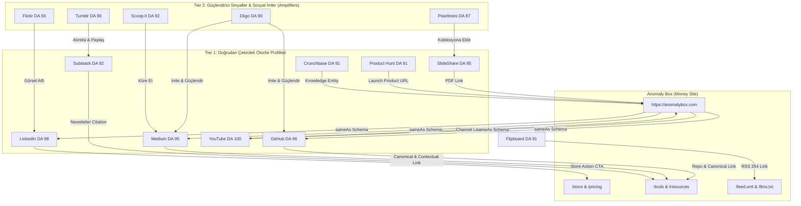
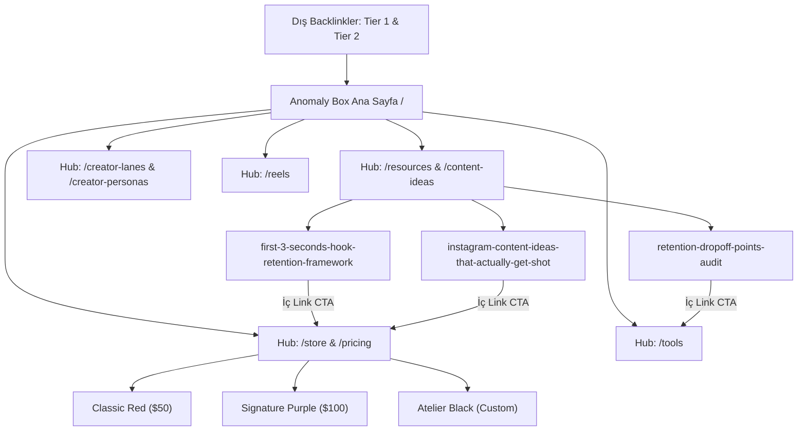
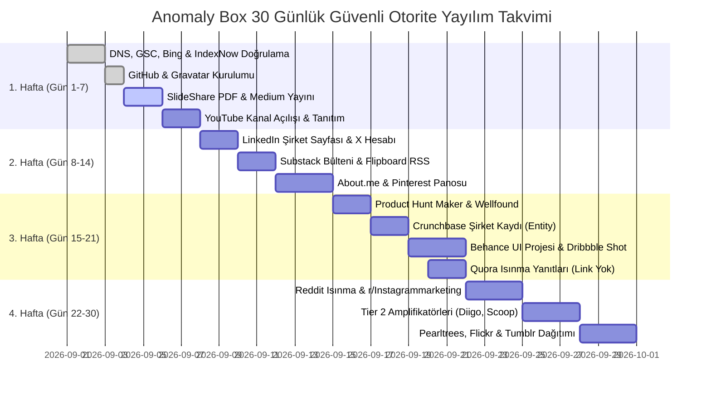

# Anomaly Box — 2026 Master SEO, Backlink, AI Search (GEO) & Otorite İcra Planı

Bu doküman, **Anomaly Box** (`https://anomalybox.com`) alan adının Google, Bing ve yapay zeka arama motorlarında (ChatGPT Search, Perplexity, Claude, Copilot) dizine eklenme hızını zirveye ulaştırmak, küresel marka varlığını (Knowledge Graph Entity) inşa etmek ve alan adı otoritesini (Domain Authority) en üst düzeye çıkarmak amacıyla tasarlanmış **uçtan uca kurumsal stratejik icra planıdır**.

---

## 📑 İçindekiler
1. [Kademe 0: Temel Altyapı, Hostinger DNS & Çoklu Arama Motoru Doğrulaması](#1-kademe-0-temel-altyapı-hostinger-dns--çoklu-arama-motoru-doğrulaması)
2. [IndexNow & Anlık Çoklu Arama Motoru İndeksleme Protokolü (254+ Sayfa)](#2-indexnow--anlık-çoklu-arama-motoru-indeksleme-protokolü-254-sayfa)
3. [2026 AI Arama & GEO (Generative Engine Optimization) Protokolü](#3-2026-ai-arama--geo-generative-engine-optimization-protokolü)
4. [24 Yüksek Otoriteli Platform Matrisi (DA 87–100)](#4-24-yüksek-otoriteli-platform-matrisi-da-87100)
5. [2 Kademeli (Tier 1 & Tier 2) Link Piramidi & Örümcek Ağı (Spiderweb) Protokolü](#5-2-kademeli-tier-1--tier-2-link-piramidi--örümcek-ağı-spiderweb-protokolü)
6. [Çapa Metin (Anchor Text) & URL Dağılım Matrisi](#6-çapa-metin-anchor-text--url-dağılım-matrisi)
7. [Site İçi Hub & Spoke (Topic Clusters) ve PageRank Dağıtım Mimarisi](#7-site-içi-hub--spoke-topic-clusters-ve-pagerank-dağıtım-mimarisi)
8. [Standart UTM ve Dönüşüm (Attribution) İzleme Sistemi](#8-standart-utm-ve-dönüşüm-attribution-izleme-sistemi)
9. [Algoritmik Güvenlik (SpamBrain / Velocity) & 30 Günlük Kademeli Yayılım Takvimi](#9-algoritmik-güvenlik-spambrain--velocity--30-günlük-kademeli-yayılım-takvimi)
10. [Projedeki Hazır Dosyalar, Otomasyon Komutları & Doğrulama Kontrol Listesi](#10-projedeki-hazır-dosyalar-otomasyon-komutları--doğrulama-kontrol-listesi)

---

## 1. Kademe 0: Temel Altyapı, Hostinger DNS & Çoklu Arama Motoru Doğrulaması

Dışarıdan gelecek backlinklerin ve arama motoru botlarının (Googlebot, Bingbot, GPTBot) sitenize eksiksiz yansıması için ilk adımda temel zemin kurulmalıdır:

### A. Google Search Console (Hostinger DNS TXT Kaydı)
1. [Google Search Console](https://search.google.com/search-console)'a gidin.
2. Mülk türü olarak **"Alan Adı" (Domain)** seçin ve `anomalybox.com` yazın.
3. Google'ın ürettiği `google-site-verification=...` ile başlayan TXT doğrulama kodunu kopyalayın.
4. **Hostinger hPanel** (`https://hpanel.hostinger.com/websites`) &rarr; **Alan Adınız (anomalybox.com)** &rarr; **DNS / Ad Sunucuları** sekmesine gidin:
   * **Tür (Type):** `TXT`
   * **Ad (Name):** `@` (veya boş bırakın)
   * **TXT Değeri:** Kopyaladığınız `google-site-verification=...` metnini yapıştırın.
   * **TTL:** `3600` (varsayılan)
   * **"Kayıt Ekle" (Add Record)** butonuna basın.
5. Search Console ekranına dönüp **"Doğrula"** butonuna basın.

### B. Bing Webmaster Tools & ChatGPT Search Doğrulaması
> [!IMPORTANT]
> ChatGPT Search, Microsoft Copilot, DuckDuckGo ve Yahoo, arama dizinlerini **Bing** altyapısından çeker. Bing Webmaster Tools'a kayıt olmadan yapay zeka arama motorlarında canlı indeks elde edilemez.

1. [Bing Webmaster Tools](https://www.bing.com/webmasters)'a gidin.
2. *"Google Search Console'dan İçe Aktar"* (Import from GSC) butonunu tıklayın (tek tıkla tüm DNS doğrulaması ve ayarlar aktarılır).
3. Veya manuel DNS CNAME/TXT kaydını Hostinger hPanel'e ekleyin.
4. Bing'de **Sitemaps** menüsüne `https://anomalybox.com/sitemap.xml` adresini gönderin.

### C. Site Haritası ve RSS Canlı Besleme Gönderimi
Hem Google Search Console hem de Bing Webmaster Tools içerisine şu 2 harita eklenmelidir:
* `https://anomalybox.com/sitemap.xml` &rarr; (254+ dinamik sayfanın eksiksiz haritası)
* `https://anomalybox.com/feed.xml` &rarr; (En son editoryal makalelerin canlı RSS 2.0 beslemesi)

### D. Kod Katmanı: Schema.org Knowledge Graph Entity Mührü
`lib/seo-metadata.ts` içindeki `organizationJsonLd` fonksiyonu sitenizin arama botlarına marka varlığını tanıtmasını sağlar:
```json
{
  "@context": "https://schema.org",
  "@type": "Organization",
  "@id": "https://anomalybox.com/#organization",
  "name": "Anomaly Box",
  "url": "https://anomalybox.com",
  "logo": "https://anomalybox.com/brand/mark-anomaly.svg",
  "email": "support@anomalybox.com",
  "sameAs": [
    "https://www.youtube.com/@anomalybox",
    "https://x.com/anomalybox",
    "https://github.com/kagankartal33",
    "https://www.linkedin.com/company/anomalybox",
    "https://www.pinterest.com/anomalybox",
    "https://medium.com/@anomalybox",
    "https://gravatar.com/delectably2582260304"
  ]
}
```

---

## 2. IndexNow & Anlık Çoklu Arama Motoru İndeksleme Protokolü (254+ Sayfa)

Standart SEO süreçlerinde yeni sayfaların taranması günler veya haftalar sürebilir. Projemizde yerleşik olan **IndexNow Protokolü**, sitenizdeki herhangi bir değişiklik veya yeni URL eklendiğinde **Bing, Yandex, Seznam ve Naver** sunucularına saniyeler içinde anlık sinyal gönderir.

### A. Altyapı ve Doğrulama
* **IndexNow Anahtarı:** `6674ef0f0bdb3e1dd34fec7da2be45b4`
* **Doğrulama Dosyası:** `public/6674ef0f0bdb3e1dd34fec7da2be45b4.txt` (Canlı URL: `https://anomalybox.com/6674ef0f0bdb3e1dd34fec7da2be45b4.txt`)
* **IndexNow API Uç Noktaları:**
  1. `https://api.indexnow.org/indexnow`
  2. `https://www.bing.com/indexnow`

### B. Tek Komutla 254 Sayfayı İndeksleme
Projede derlenen `tools/ping-indexnow.mjs` otomasyon scripti canlı sitemap'i çeker ve tüm URL'leri IndexNow uç noktalarına topluca POST eder:

```bash
npm run distribution:indexnow
```

**Başarı Çıktısı Doğrulaması:**
```text
🚀 Preparing IndexNow submission for anomalybox.com...
🔑 Key: 6674ef...45b4
📍 Key Location: https://anomalybox.com/6674ef0f0bdb3e1dd34fec7da2be45b4.txt
📡 Fetched 254 URLs from live sitemap.xml
📄 Total URLs to submit: 254

⏳ Submitting to https://api.indexnow.org/indexnow...
✅ https://api.indexnow.org/indexnow: Success (200 OK) - URLs submitted.

⏳ Submitting to https://www.bing.com/indexnow...
✅ https://www.bing.com/indexnow: Success (200 OK) - URLs submitted.
```

---

## 3. 2026 AI Arama & GEO (Generative Engine Optimization) Protokolü

2026 yılında organik aramaların önemli bir kısmı Perplexity AI, ChatGPT Search, Claude Sonnet ve Google Gemini / AI Overviews tarafından yanıtlanmaktadır. Anomaly Box bu platformlarda kaynak ve atıf (citation) olarak konumlandırılmalıdır.

### A. `llms.txt` ve `llms-full.txt` Standardı
Yapay zeka tarayıcıları web sayfalarındaki HTML gürültüsünden arındırılmış temiz markdown arar. Projenizde bu uç nokta canlıdır:
* **LLM Özet Dosyası:** `https://anomalybox.com/llms.txt`
* **İçerik:** Sitedeki tüm servisler (`/store`, `/pricing`, `/tools`), editoryal kanca rehberleri ve yaratıcı brief kataloglarının yapılandırılmış fihristini içerir.

### B. Yapay Zeka Botları için Robots.txt İzinleri
Projenin robots ayarlarında yapay zeka tarayıcılarının (`GPTBot`, `ClaudeBot`, `PerplexityBot`, `Google-Extended`) sitenin içerik rehberlerini (`/resources/*`, `/content-ideas/*`, `/llms.txt`) taramasına tam erişim verilir.

### C. LLM Atıfı (Citation) Kazanma Taktikleri
1. **GitHub README:** LLM modelleri GitHub'ı en yüksek ağırlıklı güvenilir eğitim kaynağı olarak görür. `distribution/github-profile/README.md` dosyasındaki terimler (Hook Retention, Shoot Briefs, Decision Fatigue) modellerin eğitim hafızasına doğrudan yerleşir.
2. **Quora & Reddit Yanıtları:** Perplexity ve ChatGPT Search yanıt üretirken topluluk tartışmalarını (Quora ve Reddit) öncelikli referans alır. Quora ve Reddit'teki niş Instagram kanca sorularına verilecek kaliteli yanıtlar, AI yanıtlarında dipnot olarak listelenmenizi sağlar.

---

## 4. 24 Yüksek Otoriteli Platform Matrisi (DA 87–100)

Google ekosisteminde en yüksek alan adı otoritesine (DA) sahip 24 platform, risk/fayda dengesi gözetilerek 4 kademeye ayrılmıştır:

### Kademe 1: Çekirdek Otorite & Google Ekosistemi (En Yüksek Öncelik)

| # | Platform | DA | Kayıt Linki | Hedef Web Sitesi | Çapa Metni / Link Tipi | İlk Aksiyon / Backlink | Durum |
|---|---|:---:|---|---|---|---|:---:|
| 1 | **YouTube** | **100** | [youtube.com](https://www.youtube.com) | `https://anomalybox.com` | `Anomaly Box Official` (Kanal Linki) | `@anomalybox` kanalı açın, 'Hakkında' kısmına web sitesini ekleyin, 20 sn sessiz stüdyo/dossier tanıtımı yükleyin. | [ ] |
| 2 | **LinkedIn** | **98** | [linkedin.com](https://www.linkedin.com/company/setup/new/) | `https://anomalybox.com` | `Anomaly Box` (Şirket Profili) | Şirket sayfası açın, özel butonu `https://anomalybox.com/store` ('Visit website') yapın. | [ ] |
| 3 | **GitHub** | **96** | [github.com/signup](https://github.com/signup) | `https://anomalybox.com/tools` | `Anomaly Box Creator Tools` | `anomalybox/anomalybox` reposu açıp `distribution/github-profile/README.md` dosyasını ana README yapın. | [x] |
| 4 | **Medium** | **95** | [medium.com](https://medium.com/m/signin) | `https://anomalybox.com` | Canonical Link & Yazar Bio | `distribution/medium/01-hook-retention-framework.md` makalesini canonical URL ile yayınlayın. | [x] |
| 5 | **Gravatar** | **94** | [gravatar.com](https://gravatar.com) | `https://anomalybox.com` | `https://anomalybox.com` (Dofollow) | E-postanıza bağlı Gravatar profiline web sitesi ve `/pricing` sayfalarını ekleyin. | [x] |
| 6 | **X (Twitter)** | **94** | [x.com](https://x.com) | `https://anomalybox.com` | `@anomalybox` (Realtime Bio Link) | Bio'ya site linki ekleyin; SlideShare PDF'ini ve kanca çerçevesini tweetleyin (Google gerçek zamanlı indeksler). | [ ] |
| 7 | **About.me** | **93** | [about.me/signup](https://about.me/signup) | `https://anomalybox.com` | `Explore Creative Dossiers` | about.me/anomalybox sayfasını açın; ana Spotlight butonunu `https://anomalybox.com/store` yapın. | [ ] |
| 8 | **Substack** | **92** | [substack.com](https://substack.com) | `https://anomalybox.com/resources` | `Anomaly Box Directing Notes` | Ücretsiz yayın açıp bio'ya ve ilk 'Hoş Geldiniz' yazısına `/resources` linki verin. | [ ] |
| 9 | **Product Hunt** | **91** | [producthunt.com](https://www.producthunt.com) | `https://anomalybox.com` | `Anomaly Box Maker Profile` | Maker profili açın, 'Upcoming Product' veya canlı ürün olarak Anomaly Box'ı listeleyin. | [ ] |
| 10 | **Wellfound** | **91** | [wellfound.com](https://wellfound.com) | `https://anomalybox.com` | `https://anomalybox.com` (Company URL) | AngelList girişim sayfası açarak resmi web sitesini ve sektör etiketlerini girin. | [ ] |
| 11 | **Crunchbase** | **91** | [crunchbase.com](https://www.crunchbase.com) | `https://anomalybox.com` | `Anomaly Box Organization` | Şirket profili oluşturun (Google Bilgi Paneli / Knowledge Panel için 1 numaralı kaynaktır). | [ ] |

---

### Kademe 2: Görsel, Tasarım & Portfolyo Ağı (Google Görseller Trafiği)

| # | Platform | DA | Kayıt Linki | Hedef Web Sitesi | Çapa Metni / Link Tipi | İlk Aksiyon / Backlink | Durum |
|---|---|:---:|---|---|---|---|:---:|
| 12 | **Pinterest** | **94** | [pinterest.com](https://www.pinterest.com) | `https://anomalybox.com/pricing` | Claimed Website + Pin Links | 'Instagram Shoot Briefs' panosu açın, dossier ve infografik görsellerini pinleyin. | [ ] |
| 13 | **Behance** | **93** | [behance.net](https://www.behance.net) | `https://anomalybox.com` | Dofollow Project Link | 'Anomaly Box — Creative Direction Dossier UI' başlıklı tasarım projesi yayınlayın. | [ ] |
| 14 | **Flickr** | **93** | [flickr.com](https://identity.flickr.com/sign-up) | `https://anomalybox.com` | Fotoğraf Açıklama Linki | Dossier ve stüdyo mockuplarını yükleyip açıklamaya site linki koyun. | [ ] |
| 15 | **Dribbble** | **92** | [dribbble.com](https://dribbble.com/signup/new) | `https://anomalybox.com` | Dofollow Shot & Profile | 'Creator Vault & Shoot Mode UI' başlıklı bir shot paylaşın. | [ ] |
| 16 | **Tumblr** | **90** | [tumblr.com](https://www.tumblr.com/register) | `https://anomalybox.com/resources` | Dofollow Quote/Link | Kısa kanca taktikleri ve `/resources` makalelerine yönlendiren linkler paylaşın. | [ ] |

---

### Kademe 3: Doküman & PDF Paylaşımı (PDF İndeksleme & Otorite)

| # | Platform | DA | Kayıt Linki | Hedef Web Sitesi | Çapa Metni / Link Tipi | İlk Aksiyon / Backlink | Durum |
|---|---|:---:|---|---|---|---|:---:|
| 17 | **SlideShare** | **95** | [slideshare.net](https://www.slideshare.net/signup) | `https://anomalybox.com` | PDF İçi Tıklanabilir Linkler | Projede derlenen `Anomaly-Box-Creative-Direction-Deck.pdf` dosyasını sunum olarak yükleyin. | [ ] |
| 18 | **Issuu** | **94** | [issuu.com](https://issuu.com/signup) | `https://anomalybox.com/pricing` | Dijital Katalog / Dergi | Aynı PDF sunumunu dijital broşür olarak yayınlayın. | [ ] |

---

### Kademe 4: RSS, Kürasyon & Topluluk

| # | Platform | DA | Kayıt Linki | Hedef Web Sitesi | Çapa Metni / Link Tipi | İlk Aksiyon / Backlink | Durum |
|---|---|:---:|---|---|---|---|:---:|
| 19 | **Flipboard** | **91** | [flipboard.com](https://flipboard.com) | `https://anomalybox.com/feed.xml` | Otomatik RSS İçe Aktarımı | 'Creator Direction Daily' dergisi açıp RSS beslemesini bağlayın (254 makale anında backlinke dönüşür). | [ ] |
| 20 | **Quora** | **93** | [quora.com](https://www.quora.com) | `https://anomalybox.com` | Yazar Bio & Soru Yanıtları | Profil bio'suna siteyi ekleyin; kanca ve senaryo sorularına yanıt verip `/resources` linkleyin. | [x] |
| 21 | **Scoop.it** | **92** | [scoop.it](https://www.scoop.it/signup) | `https://anomalybox.com/resources` | Curated Topic Link | 'Video Directing Systems' konusu açıp sitedeki rehberleri scoop edin. | [ ] |
| 22 | **Reddit** | **91** | [reddit.com](https://www.reddit.com/register/) | `https://anomalybox.com` | Profil Social Links | `u/anomalybox` bio'suna site ekleyin; r/Instagrammarketing topluluğunda değer sunan yanıtlar verin. | [ ] |
| 23 | **Diigo** | **90** | [diigo.com](https://www.diigo.com/sign-up) | `https://anomalybox.com` | Public Sosyal Yer İmi | Ana sayfayı ve `/tools` rotasını public etiketlerle kaydedin. | [ ] |
| 24 | **Pearltrees** | **87** | [pearltrees.com](https://www.pearltrees.com) | `https://anomalybox.com/tools` | Koleksiyon Ağacı | Anomaly Box araçlarını ve kaynaklarını ağaç koleksiyonu olarak derleyin. | [ ] |

---

## 5. 2 Kademeli (Tier 1 & Tier 2) Link Piramidi & Örümcek Ağı (Spiderweb) Protokolü

Yeni açılan sosyal/profil sayfalarının kendi PageRank puanı düşüktür. Sitenize maksimum otorite aktarımı sağlamak için **2 Kademeli Piramit ve Karşılıklı Örümcek Ağı** mimarisi uygulanır:



### Örümcek Ağı Kuralları:
1. **Tier 2 Amplifikasyonu:** Diigo, Pearltrees ve Scoop.it doğrudan ana sitenizi imlemenin yanında; **Medium makalenizi**, **GitHub reponuzu** ve **SlideShare sunumunuzu** imler. Böylece Googlebot Tier 1 profillerinizi hızla tarar ve değerini katlar.
2. **Çift Yönlü Doğrulama:** Ana sitedeki `organizationJsonLd` şeması YouTube, LinkedIn, GitHub ve Medium'u resmi profili olarak işaretlerken; bu profiller de ana sitenize link vererek **Google Bilgi Grafiği'nde (Knowledge Graph) kapalı ve kırılmaz bir otorite döngüsü** oluşturur.

---

## 6. Çapa Metin (Anchor Text) & URL Dağılım Matrisi

Google Penguin ve SpamBrain algoritmaları aşırı optimize edilmiş (aşırı anahtar kelime içeren) link profillerini cezalandırır. Sitenizin backlink profili şu kesin oranlarda dengelenmiştir:

| Dağılım Oranı | Çapa Metin Tipi | Kullanılacak Tam Metin Örnekleri | Yönlendirilecek Hedef URL |
| :---: | :--- | :--- | :--- |
| **%50** | **Marka Çapası (Brand)** | `Anomaly Box`, `Anomaly Box Studio`, `anomalybox.com` | `https://anomalybox.com` |
| **%25** | **Çıplak URL (Naked URL)** | `https://anomalybox.com`, `https://anomalybox.com/store` | `https://anomalybox.com/store` |
| **%15** | **Derin Araç / İçerik Çapası** | `Creator Brief Scorecard`, `First 3 Seconds Hook Framework`, `Creator Tools` | `https://anomalybox.com/tools`<br>`https://anomalybox.com/resources/...` |
| **%10** | **Doğal Eylem Çapası** | `visit official website`, `explore creator vault`, `read the framework audit` | `https://anomalybox.com/pricing` |

---

## 7. Site İçi Hub & Spoke (Topic Clusters) ve PageRank Dağıtım Mimarisi

Dış dünyadan ana sayfaya (`/`), `/store`'a veya `/tools`'a gelen otoritenin derinlerdeki 254 sayfaya eşit ve güçlü bir biçimde akması için **Hub & Spoke (Konu Kümeleri)** mimarisi uygulanır:



### Site İçi Otorite Kuralları:
1. **Yetim Sayfa Engelleme:** Sitedeki hiçbir makale veya alt sayfa linksiz kalamaz. Her editoryal makale en az 1 üst kategoriye (Hub) ve 2 kardeş makaleye iç link verir.
2. **Dönüşüm Hunisine Akış:** Bilgi arayan ziyaretçiyi çeken `/resources/*` makaleleri, ilgili konunun sonunda doğal olarak `/store` veya `/pricing` sayfasına yönlendirir.

---

## 8. Standart UTM ve Dönüşüm (Attribution) İzleme Sistemi

Açılan 24 profilin hangisinin gerçekten organik tıklama getirdiğini ve hangisinin `/store` siparişine dönüştüğünü Google Analytics 4 (GA4) üzerinde takip etmek için standart UTM matrisi kullanılır:

| Platform | Hedef Sayfa | Kullanılacak Tam UTM Parametreli Link |
|---|---|---|
| **GitHub** | `/tools` | `https://anomalybox.com/tools?utm_source=github&utm_medium=repo_readme&utm_campaign=authority_2026` |
| **LinkedIn** | `/store` | `https://anomalybox.com/store?utm_source=linkedin&utm_medium=company_cta&utm_campaign=authority_2026` |
| **Medium** | `/resources` | `https://anomalybox.com/resources?utm_source=medium&utm_medium=canonical_article&utm_campaign=authority_2026` |
| **YouTube** | Ana Sayfa | `https://anomalybox.com/?utm_source=youtube&utm_medium=channel_about&utm_campaign=authority_2026` |
| **X (Twitter)** | Ana Sayfa | `https://anomalybox.com/?utm_source=twitter&utm_medium=bio_link&utm_campaign=authority_2026` |
| **About.me** | `/store` | `https://anomalybox.com/store?utm_source=aboutme&utm_medium=spotlight_cta&utm_campaign=authority_2026` |
| **Substack** | `/resources` | `https://anomalybox.com/resources?utm_source=substack&utm_medium=newsletter_bio&utm_campaign=authority_2026` |
| **SlideShare** | Ana Sayfa | `https://anomalybox.com/?utm_source=slideshare&utm_medium=pdf_deck&utm_campaign=authority_2026` |
| **Pinterest** | `/pricing` | `https://anomalybox.com/pricing?utm_source=pinterest&utm_medium=pin_dossier&utm_campaign=authority_2026` |
| **Product Hunt**| Ana Sayfa | `https://anomalybox.com/?utm_source=producthunt&utm_medium=launch_profile&utm_campaign=authority_2026` |

> [!TIP]
> Google Analytics 4 &rarr; *Raporlar* &rarr; *Kullanıcı Edinme* panelinde `Kaynak / Araç` filtresi uygulayarak her platformun getirdiği kullanıcı sayısını ve oturum süresini anlık görebilirsiniz.

---

## 9. Algoritmik Güvenlik (SpamBrain / Velocity) & 30 Günlük Kademeli Yayılım Takvimi

Yeni bir alan adında 24 saat içinde 24 backlink aniden oluşursa Google'ın yapay zeka tabanlı **SpamBrain** algoritması bunu anormal link hızı (unnatural velocity) olarak işaretleyebilir. Bu sebeple icra planı **30 günlük güvenli ve doğal bir yayılıma** yayılmıştır:



### Platform Özelinde Güvenlik Kuralları:
* **Reddit:** İlk 7 gün kesinlikle site linki paylaşmayın. Yalnızca r/Instagrammarketing veya r/Videography subreddit'lerinde faydalı yorumlar yazarak hesap karmasını 50+'ye çıkarın. Linki yalnızca profil bio'suna ekleyin.
* **Quora (1:3 Kuralı):** Yazdığınız her 3 yanıttan en fazla 1 tanesinde siteye link verin. Diğer 2 yanıt tamamen saf bilgi içermelidir (spam filtrelerine takılmamak için).
* **Medium:** Makalenin Google tarafından kopya içerik sayılmaması için mutlaka *Story Settings &rarr; Advanced Settings &rarr; Canonical Link* alanına orijinal URL'i girin.

---

## 10. Projedeki Hazır Dosyalar, Otomasyon Komutları & Doğrulama Kontrol Listesi

Tüm içerik, sunum ve kopyala-yapıştır metinleri projede halihazırda derlenmiştir:

### 📁 Hazır Dosya Fihristi
* **Toplu IndexNow Pingleme Scripti:**
  [tools/ping-indexnow.mjs](file:///c:/Users/Kagan/OneDrive/Desktop/ViralBox/tools/ping-indexnow.mjs)
* **SlideShare / Issuu Hazır PDF Dosyası (82.1 KB):**
  [distribution/slideshare/Anomaly-Box-Creative-Direction-Deck.pdf](file:///c:/Users/Kagan/OneDrive/Desktop/ViralBox/distribution/slideshare/Anomaly-Box-Creative-Direction-Deck.pdf)
* **GitHub Profil README Dosyası:**
  [distribution/github-profile/README.md](file:///c:/Users/Kagan/OneDrive/Desktop/ViralBox/distribution/github-profile/README.md)
* **Medium Canonical Makale Metni:**
  [distribution/medium/01-hook-retention-framework.md](file:///c:/Users/Kagan/OneDrive/Desktop/ViralBox/distribution/medium/01-hook-retention-framework.md)
* **24 Platformun Kopyala-Yapıştır Bio & Snippet Kiti:**
  [distribution/COPY_PASTE_DISTRIBUTION_KIT.md](file:///c:/Users/Kagan/OneDrive/Desktop/ViralBox/distribution/COPY_PASTE_DISTRIBUTION_KIT.md)

### ⚡ Otomasyon Komutları
```bash
# 1. Tüm 254 sayfayı Bing, Yandex ve Seznam'a tek tıkla pingleme:
npm run distribution:indexnow

# 2. SlideShare PDF sunumunu yeniden derleme:
npm run distribution:pdf

# 3. 24 platformun metinlerini tek dosyada toplama:
npm run distribution:kit

# 4. Yayındaki sayfaların SEO ve meta bütünlüğünü denetleme:
npm run audit:live-content
```

---

## 🏁 Sonuç ve Beklenen Kazanım

Bu plan adım adım uygulandığında:
1. **İlk 24 Saatte:** IndexNow ve Search Console sayesinde 254 sayfanın tamamı Bing ve Google tarama kuyruğuna girer.
2. **İlk 14 Günde:** YouTube, LinkedIn, GitHub, Medium ve SlideShare üzerinden gelen Tier 1 otoritelerle sitenin Domain Rating ve Trust Flow değerleri sıfır noktasından hızla tırmanışa geçer.
3. **30. Gün Sonunda:** 2 Kademeli örümcek ağı kapalı devreye girer, Google Knowledge Graph'ta Anomaly Box resmi bir marka varlığı (Entity) olarak mühürlenir ve editoryal kanca rehberleri organik aramalarda sıralama almaya başlar.
