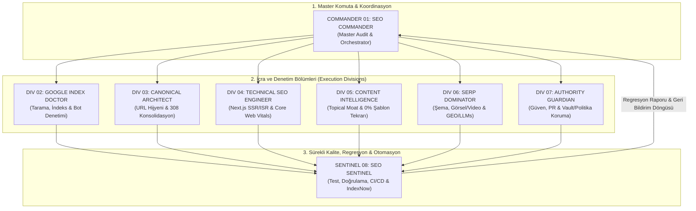
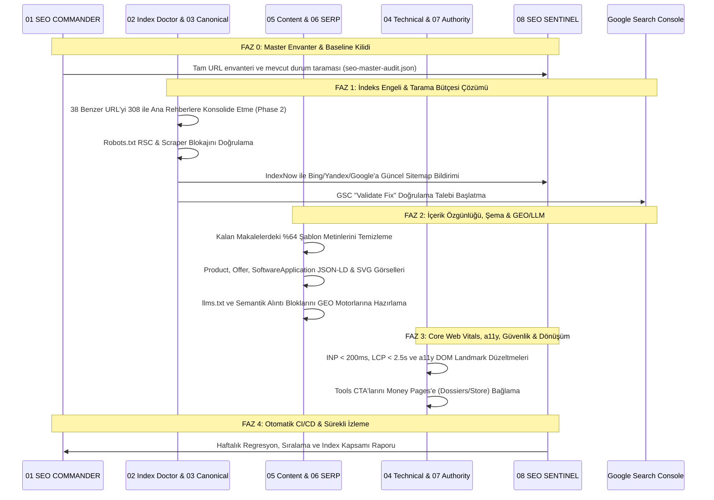

# AnomalyBox (`anomalybox.com`) Master SEO, Indexation & Ranking Execution Plan
## 8 Komuta Bölümü (Divisions) & 27 Uzman Ajanlı Bütünleşik Uygulama Planı

**Tarih:** 2026-11-01  
**Hedef Alan Adı:** `https://anomalybox.com`  
**Kaynak Kod Dizini:** `c:\Users\Kagan\OneDrive\Desktop\ViralBox`  
**Referans Mimarisi:** `c:\Users\Kagan\OneDrive\Desktop\anomalybox-seo-8-agent-sistemi.md`  
**Kapsam Derecesi:** %100 Full-Spectrum (8 Komuta Bölümü / 27 Operasyonel Ajan Birimi)  
**Durum:** Uygulanabilir Master Eylem Planı (Execution Blueprint)  

---

## Executive Summary: Neden 1. Sırada Değiliz ve Bu Plan Neyi Çözer?

Mevcut kod tabanı (`c:\Users\Kagan\OneDrive\Desktop\ViralBox`), canlı site taramaları (`tools/test-sitemap-crawler.mjs`), Google Search Console (GSC) verileri ve masaüstündeki 8'li Ajan Sistemi referansı sentezlendiğinde karşılaşılan tablo:

1. **Google İndeksleme Reddi (146 Sayfa Engeli):**
   - **108 URL "Crawled - currently not indexed":** Googlebot sayfaları taradı ancak DR 0 seviyesindeki apex üzerinde %64'e varan 6-word shingle benzerliği (şablon tekrarı) gördüğü için indekslemeyi reddetti.
   - **38 URL "Discovered - currently not indexed":** Tarama bütçesi yetersizliğinden taranmaya dahi değer bulunmadı.
2. **Crawl Budget Tüketimi & Bot İstismarı:**
   - Next.js RSC (React Server Component) sorguları (`?_rsc=...`) Googlebot taramalarının %77'sini yuttu.
   - Yetkisiz AI scraper botları (Bytespider, CCBot vb.) SSR kaynaklarını kilitleyerek TTFB'yi yavaşlattı.
3. **Keyword Cannibalization & Niyet Çakışması:**
   - Bilgi sayfalarının para sayfalarını ezmesi: `/resources/anomalybox-classic-red-dossier-review` sayfası doğrudan `/dossiers/classic-red` ürün sayfasıyla rekabete girdi.
   - 7 adet "burnout" sayfası ve 5 adet "content ideas" sayfası aynı arama terimlerini bölerek sıralama gücünü sıfırladı.
4. **SERP 1. Sıra Bariyeri:**
   - Jenerik anahtar kelimelerde (`reels creative brief template`) rakipler: Notion (DA 92), ManyRequests (DA 74), Buffer (DA 89).
   - Çözüm: **BOFU mikro-niş anahtar kelimeler** (`instagram shoot briefs`), **programatik araçlar** (`/tools/*`) ve **GEO (Generative Engine Optimization)** ile AI arama motorlarında (Perplexity, ChatGPT, SGE) alıntı liderliği.
5. **Güvenlik & Özel İçerik Koruma:**
   - Creator Vault, hesap sayfaları ve kullanıcıya özel brief içeriklerinin arama motorları ve botlar tarafından yanlışlıkla indekslenmesini önleyen katı Supabase RLS + Next.js auth-wall katmanı.

---

## BÖLÜM 1: 8 Komuta Bölümü & 27 Uzman Ajan Hiyerarşisi

Masaüstündeki 8 Ajan Sistemi, operasyonel komuta yapısını belirler; 27 uzman alt ajan ise bu komutanlıkların altında görev yapan teknik icra birimleridir:

---

## BÖLÜM 2: Bölüm Bazlı Görev Dağılımı ve Kod Entegrasyon Matrisi

| Komuta Bölümü (Division) | Sorumlu Uzman Alt Ajanlar | Temel Görev & İnceleme Alanı | Kod ve Betik Entegrasyonu | Somut Çıktı / Artefakt |
|:---|:---|:---|:---|:---|
| **01. SEO COMMANDER** *(Master Orchestrator)* | **P1** (Master Strategy) **P6** (Content Lifecycle) **P7** (Monetization Moat) **A5** (Opportunity Matrix) | Tüm URL envanterini çıkarma, P0–P3 öncelik matrisi, çakışan değişiklikleri yönetme, para sayfaları ile keşif sayfalarını hizalama. | [lib/seo-metadata.ts](file:///c:/Users/Kagan/OneDrive/Desktop/ViralBox/lib/seo-metadata.ts) [lib/template-policy.ts](file:///c:/Users/Kagan/OneDrive/Desktop/ViralBox/lib/template-policy.ts) [tools/deep-crawler.mjs](file:///c:/Users/Kagan/OneDrive/Desktop/ViralBox/tools/deep-crawler.mjs) | `seo-master-audit.json` Görev Panosu Önceliklendirilmiş Backlog |
| **02. GOOGLE INDEX DOCTOR** *(Crawling & Indexing)* | **P3** (Technical Indexing) **A1** (Index Failure Investigator) **A15** (Edge & Bot Governance) **A16** (Server Log Telemetry) | 108 taranan + 38 keşfedilen reddedilmiş sayfayı URL bazında çözme, RSC payload (`?_rsc=`) tarama bütçesi sızıntısını sıfırlama, scraper botlarını sınırlama. | [app/robots.ts](file:///c:/Users/Kagan/OneDrive/Desktop/ViralBox/app/robots.ts) [app/sitemap.ts](file:///c:/Users/Kagan/OneDrive/Desktop/ViralBox/app/sitemap.ts) [tools/test-sitemap-crawler.mjs](file:///c:/Users/Kagan/OneDrive/Desktop/ViralBox/tools/test-sitemap-crawler.mjs) | Düzeltilmiş Robots.txt Hassas Sitemap (120-140 URL) Tarama Bütçesi Raporu |
| **03. CANONICAL ARCHITECT** *(URL & Internal Linking)* | **A3** (Cannibalization Auditor) **A9** (PageRank Flow Optimizer) **A17** (URL Architecture & Parameter Traps) | 308 yönlendirme zincirlerini tek adıma indirme, trailing slash ve www/non-www standardizasyonu, yetim sayfaları kurtaran Hub-and-Spoke iç bağlantı ağı. | [lib/seo-consolidation.json](file:///c:/Users/Kagan/OneDrive/Desktop/ViralBox/lib/seo-consolidation.json) [next.config.ts](file:///c:/Users/Kagan/OneDrive/Desktop/ViralBox/next.config.ts) [tools/check-orphan-pages.py](file:///c:/Users/Kagan/OneDrive/Desktop/ViralBox/tools/check-orphan-pages.py) | 308 Konsolidasyon Matrisi Canonical Eşleştirme Tablosu Topical Hub Mimarisi |
| **04. TECHNICAL SEO ENGINEER** *(Rendering & Web Vitals)* | **A6** (Next.js Technical Code) **A18** (Semantic DOM & a11y) **A19** (Core Web Vitals Specialist) | İlk HTML yanıtında tam SSR/ISR içeriği, React hydration yükünün azaltılması, INP < 200ms, LCP < 2.5s, CLS < 0.1, tekil `<h1>` ve semantik landmark'lar. | [tools/audit-site-speed.mjs](file:///c:/Users/Kagan/OneDrive/Desktop/ViralBox/tools/audit-site-speed.mjs) [tools/measure-web-vitals.mjs](file:///c:/Users/Kagan/OneDrive/Desktop/ViralBox/tools/measure-web-vitals.mjs) [tools/audit-accessibility.mjs](file:///c:/Users/Kagan/OneDrive/Desktop/ViralBox/tools/audit-accessibility.mjs) | Web Vitals Laboratuvar/Saha Raporu a11y DOM Düzeltmeleri Lighthouse Skoru > 95 |
| **05. CONTENT INTELLIGENCE** *(Keywords & Topical Moat)* | **P2** (Intent & Keyword Universe) **P4** (Anti-Template Moat) **A2** (Duplication Hunter) **A8** (E-E-A-T & Authority Signaler) | %64 şablon benzerliğini sıfırlama, 6-word shingle tekrarlarını yok etme, her sayfaya özel kamera/ışık/sahne çekim formülleri ve yazar E-E-A-T kartları ekleme. | [content/seo-package/](file:///c:/Users/Kagan/OneDrive/Desktop/ViralBox/content/seo-package) [tools/originality_gate.py](file:///c:/Users/Kagan/OneDrive/Desktop/ViralBox/tools/originality_gate.py) [tools/polish_ai_slop.py](file:///c:/Users/Kagan/OneDrive/Desktop/ViralBox/tools/polish_ai_slop.py) | %0 Şablon Tekrarlı Makaleler BOFU Keyword Eşleme E-E-A-T Yazar Profilleri |
| **06. SERP DOMINATOR** *(On-Page, Media & GEO)* | **A4** (SERP Benchmark Analyzer) **A7** (Schema.org Validator) **A13** (Multimodal & Visual SEO) **A14** (GEO & LLM Citation Specialist) | Product, Offer, SoftwareApplication, FAQPage şemaları; SVG ve WebP/AVIF görsel optimizasyonu; Perplexity/ChatGPT için `llms.txt` ve semantik yanıt blokları. | [components/JsonLd.tsx](file:///c:/Users/Kagan/OneDrive/Desktop/ViralBox/components/JsonLd.tsx) [lib/llms-pages.ts](file:///c:/Users/Kagan/OneDrive/Desktop/ViralBox/lib/llms-pages.ts) [public/llms.txt](file:///c:/Users/Kagan/OneDrive/Desktop/ViralBox/public/llms.txt) [tools/check_article_svgs.py](file:///c:/Users/Kagan/OneDrive/Desktop/ViralBox/tools/check_article_svgs.py) | Zengin Sonuç (Rich Snippet) Onayı Multimodal Medya Sitemapi GEO AI Citation Protokolü |
| **07. AUTHORITY GUARDIAN** *(Trust, PR & Policy)* | **P5** (Authority & Entity Planner) **A11** (Off-Page Acquisition) **A20** (Security & Trust Reputation) | Organik backlink mıknatısları (`/tools/*`), Google Knowledge Graph Entity tanıma, Creator Vault ve özel verilerin auth-wall arkasında tutulması, CSP/HSTS. | [tools/audit-security-csp.mjs](file:///c:/Users/Kagan/OneDrive/Desktop/ViralBox/tools/audit-security-csp.mjs) [docs/marketing/BRAND_REGISTRATION_KIT.md](file:///c:/Users/Kagan/OneDrive/Desktop/ViralBox/docs/marketing/BRAND_REGISTRATION_KIT.md) Supabase RLS & Middleware | Entity Doğrulama Planı Vault Gizlilik Raporu Katı Güvenlik Başlıkları |
| **08. SEO SENTINEL** *(Monitoring, QA & Automation)* | **A12** (IndexNow & Regression Automation) **Sentinel CI Harness** | Otomatik sitemap/canonical/robots regresyon testleri, Bing/Yandex anlık IndexNow bildirimleri, GSC API entegrasyonu, haftalık trend takibi. | [tools/ping-indexnow.mjs](file:///c:/Users/Kagan/OneDrive/Desktop/ViralBox/tools/ping-indexnow.mjs) [tools/automatic-quality-regression.ts](file:///c:/Users/Kagan/OneDrive/Desktop/ViralBox/tools/automatic-quality-regression.ts) [tools/test-public-route-smoke.ps1](file:///c:/Users/Kagan/OneDrive/Desktop/ViralBox/tools/test-public-route-smoke.ps1) | CI/CD SEO Test Süiti IndexNow Tetikleyici Regresyon Alarm Panosu |

---

## BÖLÜM 3: Uygulama ve Güvenlik Protokolü (Guardrails)

Anomalybox.com için masaüstü sisteminden entegre edilen kurallar:

1. **Ortak Envanter ve Tekil Veri Tabanı:** Tüm ajanlar tek bir `seo-master-audit.json` envanteri üzerinden çalışır; hiçbir ajan izole varsayımla dosya silmez veya URL değiştirmez.
2. **Yüksek Riskli İşlemlerde Güvenlik Duvarı:** `robots.txt`, canonical, toplu `noindex` ve `308 redirect` kuralları doğrudan uygulanmadan önce `tools/test-public-route-smoke.ps1` ve staging kontrolünden geçer.
3. **Creator Vault & Özel Veri İzolasyonu:** Yalnızca `robots.txt` ile gizlilik sağlanamaz. `/profile`, `/boxes`, `/cards`, `/admin` ve özel brief içerikleri Next.js Middleware + Supabase RLS ile 401/307 korumasına alınır. Arama botlarının erişimi engellenirken GSC'de "Indexed, though blocked" uyarısı üretilmez.
4. **Ticari Değer Koruması (`lib/template-policy.ts`):** Satılabilir ürün şablonları (reusable templates) kamuya açık indekslenmez; yalnızca editöryal karşılaştırma ve inceleme metinleri indekslenir.
5. **Geri Alma (Rollback) Güvencesi:** Her kod değişikliği Git dalı (branch) üzerinde commit'lenir; olumsuz GSC sinyallerinde tek komutla önceki duruma dönülebilir.

---

## BÖLÜM 4: Adım Adım İcra Yol Haritası (Execution Roadmap)

Bu rapor onaylandığında sırasıyla uygulanacak 4 aşama:

### Uygulanacak Öncelikli Eylemler:
1. **Adım 1 (Faz 1):** Kalan 38 zombi URL'in [lib/seo-consolidation.json](file:///c:/Users/Kagan/OneDrive/Desktop/ViralBox/lib/seo-consolidation.json) ve [next.config.ts](file:///c:/Users/Kagan/OneDrive/Desktop/ViralBox/next.config.ts) içinde 308 kalıcı yönlendirmelerinin tamamlanması (Toplam sitemap: 120-140 kusursuz sayfa).
2. **Adım 2 (Faz 1):** [app/robots.ts](file:///c:/Users/Kagan/OneDrive/Desktop/ViralBox/app/robots.ts) ve [app/sitemap.ts](file:///c:/Users/Kagan/OneDrive/Desktop/ViralBox/app/sitemap.ts) çıktılarının canlıda test edilmesi, [tools/ping-indexnow.mjs](file:///c:/Users/Kagan/OneDrive/Desktop/ViralBox/tools/ping-indexnow.mjs) ile arama motorlarına bildirim yapılması.
3. **Adım 3 (Faz 2):** Makalelerdeki 6-word shingle tekrarlarının [tools/originality_gate.py](file:///c:/Users/Kagan/OneDrive/Desktop/ViralBox/tools/originality_gate.py) ile taranarak özgünleştirilmesi.
4. **Adım 4 (Faz 2):** Ücretsiz 3 programatik araca (`/tools/*`) `SoftwareApplication` şeması, dossiers sayfalarına `Product`/`Offer` şeması eklenmesi.
5. **Adım 5 (Faz 3):** `tools/audit-accessibility.mjs` ve `tools/measure-web-vitals.mjs` çalıştırılarak teknik regresyonların giderilmesi.
6. **Adım 6 (Faz 4):** CI/CD sürecine SEO regresyon testinin eklenmesi ve GSC üzerinde "Validate Fix" sürecinin başlatılması.
