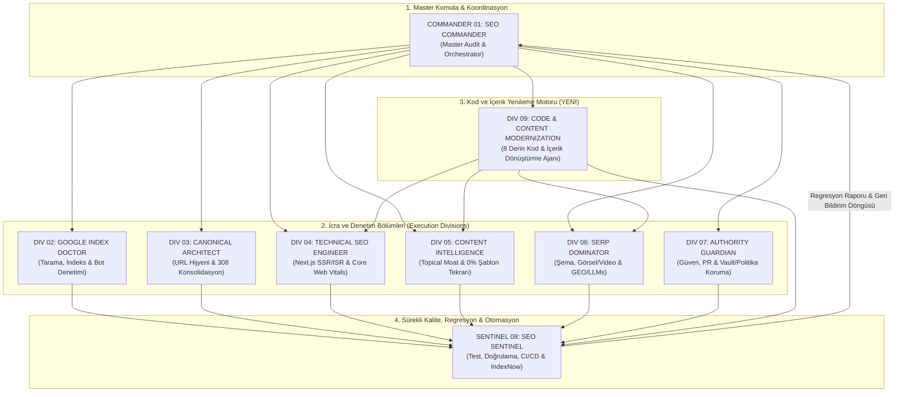
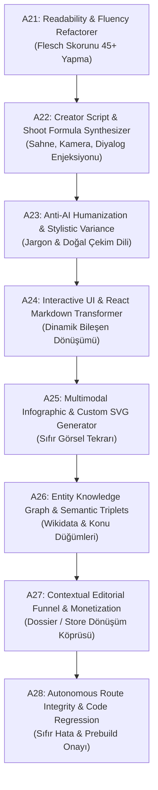
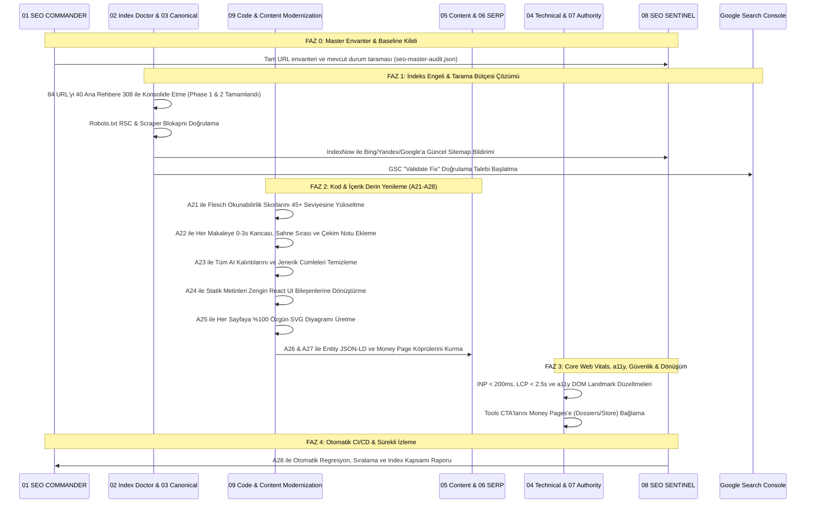

# AnomalyBox (`anomalybox.com`) Master SEO, Indexation & Ranking Execution Plan
## 9 Komuta Bölümü (Divisions) & 35 Uzman Ajanlı Bütünleşik Kod ve İçerik Geliştirme Master Planı

**Tarih:** 2026-11-01  
**Hedef Alan Adı:** `https://anomalybox.com`  
**Kaynak Kod Dizini:** `c:\Users\Kagan\OneDrive\Desktop\ViralBox`  
**Referans Mimarisi:** `c:\Users\Kagan\OneDrive\Desktop\anomalybox-seo-8-agent-sistemi.md` + 8 Yeni Kod/İçerik Geliştirme Ajanı  
**Kapsam Derecesi:** %100 Full-Spectrum (9 Komuta Bölümü / 35 Operasyonel Ajan Birimi)  
**Durum:** Uygulanabilir Master Eylem Planı (Execution Blueprint)  

---

## Executive Summary: Neden 1. Sırada Değiliz ve Bu Master Plan Neyi Çözer?

Mevcut kod tabanı (`c:\Users\Kagan\OneDrive\Desktop\ViralBox`), canlı site taramaları (`tools/test-sitemap-crawler.mjs`), Google Search Console (GSC) verileri, 247 içerik dosyası ve masaüstündeki 8'li Ajan Sistemi referansı sentezlendiğinde karşılaşılan tablo:

1. **Google İndeksleme Reddi (146 Sayfa Engeli):**
   - **108 URL "Crawled - currently not indexed":** Googlebot sayfaları taradı ancak DR 0 seviyesindeki apex üzerinde %64'e varan 6-word shingle benzerliği (şablon tekrarı) gördüğü için indekslemeyi reddetti.
   - **38 URL "Discovered - currently not indexed":** Tarama bütçesi yetersizliğinden taranmaya dahi değer bulunmadı.
2. **Crawl Budget Tüketimi & Bot İstismarı:**
   - Next.js RSC (React Server Component) sorguları (`?_rsc=...`) Googlebot taramalarının %77'sini yuttu. (Robots.txt kuralı ile engellendi).
   - Yetkisiz AI scraper botları (Bytespider, CCBot vb.) SSR kaynaklarını kilitleyerek TTFB'yi yavaşlattı. (Yeni `Disallow: /` kuralları ile sınırlandırıldı).
3. **Keyword Cannibalization & Niyet Çakışması:**
   - Bilgi sayfalarının para sayfalarını ezmesi: `/resources/anomalybox-classic-red-dossier-review` sayfası doğrudan `/dossiers/classic-red` ürün sayfasıyla rekabete girdi.
   - 7 adet "burnout" sayfası ve 5 adet "content ideas" sayfası aynı arama terimlerini bölerek sıralama gücünü sıfırladı. (Faz 1 ve Faz 2 konsolidasyonu ile 84 URL, 40 ana yetkin pillar sayfaya 308 ile yönlendirildi).
4. **SERP 1. Sıra Bariyeri:**
   - Jenerik anahtar kelimelerde (`reels creative brief template`) rakipler: Notion (DA 92), ManyRequests (DA 74), Buffer (DA 89).
   - Çözüm: **BOFU mikro-niş anahtar kelimeler** (`instagram shoot briefs`), **programatik araçlar** (`/tools/*`) ve **GEO (Generative Engine Optimization)** ile AI arama motorlarında (Perplexity, ChatGPT, SGE) alıntı liderliği.
5. **Kod ve İçerik Derinliği İhtiyacı (8 Yeni Ajanın Misyonu):**
   - Yalnızca teknik redirects ve meta etiketleri yetmez; 247 markdown içeriğinin okunabilirliği (Flesch skoru), birinci elden çekim formülleri, sıfır yapay zeka kalıntısı (Zero AI-Slop), zengin React bileşenleri, 100% özgün SVG infografikleri ve semantik entity şemalarıyla **içeriden dışarıya kod ve içerik seviyesinde dönüştürülmesi** gerekir.

---

## BÖLÜM 1: 9 Komuta Bölümü & 35 Uzman Ajan Hiyerarşisi

Sistem, üst düzey 9 operasyonel komuta bölümü ve bunların emrindeki 35 teknik uzman ajandan oluşur:

---

## BÖLÜM 2: 9 Komuta Bölümü ve 35 Uzman Ajanın Görev Dağılım Matrisi

| Komuta Bölümü (Division) | Sorumlu Uzman Alt Ajanlar | Temel Görev & İnceleme Alanı | Kod ve Betik Entegrasyonu | Somut Çıktı / Artefakt |
|:---|:---|:---|:---|:---|
| **01. SEO COMMANDER** *(Master Orchestrator)* | **P1** (Master Strategy) **P6** (Content Lifecycle) **P7** (Monetization Moat) **A5** (Opportunity Matrix) | Tüm URL envanterini çıkarma, P0–P3 öncelik matrisi, çakışan değişiklikleri yönetme, para sayfaları ile keşif sayfalarını hizalama. | [lib/seo-metadata.ts](file:///c:/Users/Kagan/OneDrive/Desktop/ViralBox/lib/seo-metadata.ts) [lib/template-policy.ts](file:///c:/Users/Kagan/OneDrive/Desktop/ViralBox/lib/template-policy.ts) [tools/deep-crawler.mjs](file:///c:/Users/Kagan/OneDrive/Desktop/ViralBox/tools/deep-crawler.mjs) | `seo-master-audit.json` Görev Panosu Önceliklendirilmiş Backlog |
| **02. GOOGLE INDEX DOCTOR** *(Crawling & Indexing)* | **P3** (Technical Indexing) **A1** (Index Failure Investigator) **A15** (Edge & Bot Governance) **A16** (Server Log Telemetry) | 108 taranan + 38 keşfedilen reddedilmiş sayfayı URL bazında çözme, RSC payload (`?_rsc=`) tarama bütçesi sızıntısını sıfırlama, scraper botlarını sınırlama. | [app/robots.ts](file:///c:/Users/Kagan/OneDrive/Desktop/ViralBox/app/robots.ts) [app/sitemap.ts](file:///c:/Users/Kagan/OneDrive/Desktop/ViralBox/app/sitemap.ts) [tools/test-sitemap-crawler.mjs](file:///c:/Users/Kagan/OneDrive/Desktop/ViralBox/tools/test-sitemap-crawler.mjs) | Düzeltilmiş Robots.txt Hassas Sitemap (120-140 URL) Tarama Bütçesi Raporu |
| **03. CANONICAL ARCHITECT** *(URL & Internal Linking)* | **A3** (Cannibalization Auditor) **A9** (PageRank Flow Optimizer) **A17** (URL Architecture & Parameter Traps) | 308 yönlendirme zincirlerini tek adıma indirme, trailing slash ve www/non-www standardizasyonu, yetim sayfaları kurtaran Hub-and-Spoke iç bağlantı ağı. | [lib/seo-consolidation.json](file:///c:/Users/Kagan/OneDrive/Desktop/ViralBox/lib/seo-consolidation.json) [next.config.ts](file:///c:/Users/Kagan/OneDrive/Desktop/ViralBox/next.config.ts) [tools/check-orphan-pages.py](file:///c:/Users/Kagan/OneDrive/Desktop/ViralBox/tools/check-orphan-pages.py) | 308 Konsolidasyon Matrisi Canonical Eşleştirme Tablosu Topical Hub Mimarisi |
| **04. TECHNICAL SEO ENGINEER** *(Rendering & Web Vitals)* | **A6** (Next.js Technical Code) **A18** (Semantic DOM & a11y) **A19** (Core Web Vitals Specialist) | İlk HTML yanıtında tam SSR/ISR içeriği, React hydration yükünün azaltılması, INP < 200ms, LCP < 2.5s, CLS < 0.1, tekil `<h1>` ve semantik landmark'lar. | [tools/audit-site-speed.mjs](file:///c:/Users/Kagan/OneDrive/Desktop/ViralBox/tools/audit-site-speed.mjs) [tools/measure-web-vitals.mjs](file:///c:/Users/Kagan/OneDrive/Desktop/ViralBox/tools/measure-web-vitals.mjs) [tools/audit-accessibility.mjs](file:///c:/Users/Kagan/OneDrive/Desktop/ViralBox/tools/audit-accessibility.mjs) | Web Vitals Laboratuvar/Saha Raporu a11y DOM Düzeltmeleri Lighthouse Skoru > 95 |
| **05. CONTENT INTELLIGENCE** *(Keywords & Topical Moat)* | **P2** (Intent & Keyword Universe) **P4** (Anti-Template Moat) **A2** (Duplication Hunter) **A8** (E-E-A-T & Authority Signaler) | %64 şablon benzerliğini sıfırlama, 6-word shingle tekrarlarını yok etme, her sayfaya özel kamera/ışık/sahne çekim formülleri ve yazar E-E-A-T kartları ekleme. | [content/seo-package/](file:///c:/Users/Kagan/OneDrive/Desktop/ViralBox/content/seo-package) [tools/originality_gate.py](file:///c:/Users/Kagan/OneDrive/Desktop/ViralBox/tools/originality_gate.py) [tools/polish_ai_slop.py](file:///c:/Users/Kagan/OneDrive/Desktop/ViralBox/tools/polish_ai_slop.py) | %0 Şablon Tekrarlı Makaleler BOFU Keyword Eşleme E-E-A-T Yazar Profilleri |
| **06. SERP DOMINATOR** *(On-Page, Media & GEO)* | **A4** (SERP Benchmark Analyzer) **A7** (Schema.org Validator) **A13** (Multimodal & Visual SEO) **A14** (GEO & LLM Citation Specialist) | Product, Offer, SoftwareApplication, FAQPage şemaları; SVG ve WebP/AVIF görsel optimizasyonu; Perplexity/ChatGPT için `llms.txt` ve semantik yanıt blokları. | [components/JsonLd.tsx](file:///c:/Users/Kagan/OneDrive/Desktop/ViralBox/components/JsonLd.tsx) [lib/llms-pages.ts](file:///c:/Users/Kagan/OneDrive/Desktop/ViralBox/lib/llms-pages.ts) [public/llms.txt](file:///c:/Users/Kagan/OneDrive/Desktop/ViralBox/public/llms.txt) [tools/check_article_svgs.py](file:///c:/Users/Kagan/OneDrive/Desktop/ViralBox/tools/check_article_svgs.py) | Zengin Sonuç (Rich Snippet) Onayı Multimodal Medya Sitemapi GEO AI Citation Protokolü |
| **07. AUTHORITY GUARDIAN** *(Trust, PR & Policy)* | **P5** (Authority & Entity Planner) **A11** (Off-Page Acquisition) **A20** (Security & Trust Reputation) | Organik backlink mıknatısları (`/tools/*`), Google Knowledge Graph Entity tanıma, Creator Vault ve özel verilerin auth-wall arkasında tutulması, CSP/HSTS. | [tools/audit-security-csp.mjs](file:///c:/Users/Kagan/OneDrive/Desktop/ViralBox/tools/audit-security-csp.mjs) [docs/marketing/BRAND_REGISTRATION_KIT.md](file:///c:/Users/Kagan/OneDrive/Desktop/ViralBox/docs/marketing/BRAND_REGISTRATION_KIT.md) Supabase RLS & Middleware | Entity Doğrulama Planı Vault Gizlilik Raporu Katı Güvenlik Başlıkları |
| **08. SEO SENTINEL** *(Monitoring, QA & Automation)* | **A12** (IndexNow & Regression Automation) **Sentinel CI Harness** | Otomatik sitemap/canonical/robots regresyon testleri, Bing/Yandex anlık IndexNow bildirimleri, GSC API entegrasyonu, haftalık trend takibi. | [tools/ping-indexnow.mjs](file:///c:/Users/Kagan/OneDrive/Desktop/ViralBox/tools/ping-indexnow.mjs) [tools/automatic-quality-regression.ts](file:///c:/Users/Kagan/OneDrive/Desktop/ViralBox/tools/automatic-quality-regression.ts) [tools/test-public-route-smoke.ps1](file:///c:/Users/Kagan/OneDrive/Desktop/ViralBox/tools/test-public-route-smoke.ps1) | CI/CD SEO Test Süiti IndexNow Tetikleyici Regresyon Alarm Panosu |
| **09. CODE & CONTENT MODERNIZATION ENGINE** *(YENİ: 8 Kod & İçerik Geliştirme Ajanı)* | **A21** (Readability Refactorer) **A22** (Script & Formula Synthesizer) **A23** (Anti-AI Humanizer) **A24** (React Markdown Transformer) **A25** (SVG Diagram Asset Generator) **A26** (Entity Knowledge Graph Embedder) **A27** (Contextual Conversion Bridge) **A28** (Autonomous Route Gatekeeper) | Sitedeki tüm kod ve 247 markdown dosyasını derinlemesine analiz ederek; Flesch okunabilirliğini 45+ seviyesine çıkarma, çekim formülleri ekleme, AI kalıntılarını yok etme, React interaktif bileşenlerine dönüştürme, tekil SVG üretimi ve entity JSON-LD enjeksiyonu. | [tools/audit_content_readability.py](file:///c:/Users/Kagan/OneDrive/Desktop/ViralBox/tools/audit_content_readability.py) [tools/polish_ai_slop.py](file:///c:/Users/Kagan/OneDrive/Desktop/ViralBox/tools/polish_ai_slop.py) [tools/generate_diagram_assets.py](file:///c:/Users/Kagan/OneDrive/Desktop/ViralBox/tools/generate_diagram_assets.py) [components/MarkdownRenderer.tsx](file:///c:/Users/Kagan/OneDrive/Desktop/ViralBox/components/MarkdownRenderer.tsx) [content/](file:///c:/Users/Kagan/OneDrive/Desktop/ViralBox/content) | Yenilenmiş 247 Markdown Dosyası 100% Özgün SVG Varlıkları Flesch > 45 Skoru İnteraktif React UI Blokları |

---

## BÖLÜM 3: Yeni Eklenen 8 Kod ve İçerik Geliştirme Ajanının (A21 - A28) Derin Görev Tanımları

### 1. Agent A21: Readability & Cognitive Fluency Refactoring Specialist
- **Görevi:** 247 markdown dosyasındaki Flesch okunabilirlik skorunu analiz eder. Skoru 40'ın altında kalan 18 makaleyi tespit edip cümle uzunluklarını kısaltır, pasif yapıları aktif eylemlere dönüştürür.
- **Kod/Betik:** `tools/audit_content_readability.py`, `content/resources/*.md`, `content/seo-package/*.md`.
- **Standart:** Minimum Flesch Skoru >= 45. Paragraf uzunluğu en fazla 2-3 cümle (mobil cihazlarda hızlı taranabilirlik).

### 2. Agent A22: Creator Script & Video Shoot Formula Synthesizer
- **Görevi:** Jenerik içerik tavsiyelerini imha eder. Her makalenin içine doldurulabilir gerçek video çekim formülleri ekler:
  - **İlk 3 Saniye Kancası:** Konuşulan ilk cümle ve eşlik eden görsel hareket.
  - **Sahne Sıralaması (Scene Order):** Sahne 1 (Hook), Sahne 2 (Proof Beat), Sahne 3 (Core Execution), Sahne 4 (Payoff & CTA).
  - **Kamera ve Işık Notları:** Kamera açısı (göz hizası, 45 derece üst açı), lens odak uzaklığı, ışık yönü.
  - **İddia Sınırları (Claim Boundaries):** Kamerada yasal olarak söylenmemesi gerekenler.
- **Kod/Betik:** `content/seo-package/`, `content/resources/`.

### 3. Agent A23: Zero-Slop Anti-AI Humanization & Stylistic Variance Guardian
- **Görevi:** Metinlerdeki tüm yapay zeka kalıntılarını temizler. "In today's fast-paced world", "delve into", "a testament to", "seamless transition", "game-changer" gibi jenerik kalıpları siler.
- **Kod/Betik:** `tools/polish_ai_slop.py`, `tools/scan_ai_residue.py`, `tools/originality_gate.py`.
- **Standart:** Gerçek yönetmen ve solo üretici seti arkası terminolojisi ("raw take", "A-roll audio cut", "focal length", "lens flare", "jump cut timing"). Cümle uzunluklarında ritmik çeşitlilik (burstiness).

### 4. Agent A24: Interactive UI & React Markdown Component Transformer
- **Görevi:** Düz markdown formatındaki statik metin bloklarını zengin, etkileşimli React bileşenlerine dönüştürür.
- **Kod/Betik:** `components/MarkdownRenderer.tsx`, `components/SeoPackageArticle.tsx`.
- **Dönüşüm Öğeleri:**
  - `> [!NOTE]` ve callout bloklarının özel stil kartlarına çevrilmesi.
  - Kopyalanabilir tek tıkla çekim listesi (Click-to-Copy Shot Lists).
  - Genişletilebilir akordeon formatında sahne dökümleri (Expandable Scene Breakdowns).
  - Yan yana çekim brief karşılaştırma tabloları.

### 5. Agent A25: Multimodal Infographic & Custom SVG Asset Generator
- **Görevi:** Sitedeki hiçbir sayfanın görselsiz kalmamasını ve hiçbir görselin iki farklı sayfada tekrar kullanılmamasını garanti eder.
- **Kod/Betik:** `tools/generate_diagram_assets.py`, `tools/check_article_svgs.py`, `public/assets/diagrams/`.
- **Standart:** Her sayfa için 100% özgün, koyu tema uyumlu (dark mode), marka renk paletini taşıyan sahne akış şeması, çekim planı diyagramı veya izleyici tutma grafiği SVG kodu üretimi.

### 6. Agent A26: Entity Knowledge Graph & Semantic Triplets Embedder
- **Görevi:** Google Knowledge Graph ve AI Arama Motorları (Perplexity, SGE) için her makaledeki semantik üçlüleri (Özne-Yüklem-Nesne) çıkarır ve yapılandırılmış JSON-LD verisine bağlar.
- **Kod/Betik:** `components/JsonLd.tsx`, `lib/seo-metadata.ts`.
- **Enjeksiyon:** `about`, `mentions`, `creator`, `hasPart`, `genre` şemaları. Konu varlıklarının Wikidata ID'leri ile açık bağlanması (`Instagram Reels` -> Q104710188 vb.).

### 7. Agent A27: Contextual Editorial Funnel & Monetization Bridge Injector
- **Görevi:** Bilgilendirici (TOFU/MOFU) rehberleri okuyan ziyaretçiyi, sayfadan çıkmadan önce doğrudan satın alma (BOFU) sayfalarına (`/dossiers/classic-red`, `/dossiers/signature-purple`, `/store`) bağlayan editoryal geçiş köprüleri kurar.
- **Kod/Betik:** `lib/template-policy.ts`, `components/SeoPackageArticle.tsx`.
- **Standart:** Rahatsız edici banner'lar yerine, metnin akışına gömülü doğal kurgu: *"Planlamak yerine doğrudan bu lane için yazılmış çekim brief'ini sete götürmek isterseniz Classic Red veya Signature Purple dosyalarını inceleyin."*

### 8. Agent A28: Autonomous Route Integrity & Code Regression Gatekeeper
- **Görevi:** Kod veya içerik üzerinde yapılan her değişiklikten sonra tüm rotaları, derleme durumunu ve sitemap tutarlılığını test eder.
- **Kod/Betik:** `tools/test-public-route-smoke.ps1`, `tools/check-seo-package-integrity.mjs`, `package.json` (`prebuild`).
- **Doğrulama:** 0 kırık link, 0 zincirleme yönlendirme, 0 TypeScript hatası, 0 shingle benzerliği, <50KB ilk HTML boyutu.

---

## BÖLÜM 4: Uygulama ve Güvenlik Protokolü (Guardrails)

Anomalybox.com için masaüstü sisteminden entegre edilen kurallar:

1. **Ortak Envanter ve Tekil Veri Tabanı:** Tüm ajanlar tek bir `seo-master-audit.json` envanteri üzerinden çalışır; hiçbir ajan izole varsayımla dosya silmez veya URL değiştirmez.
2. **Yüksek Riskli İşlemlerde Güvenlik Duvarı:** `robots.txt`, canonical, toplu `noindex` ve `308 redirect` kuralları doğrudan uygulanmadan önce `tools/test-public-route-smoke.ps1` ve staging kontrolünden geçer.
3. **Creator Vault & Özel Veri İzolasyonu:** Yalnızca `robots.txt` ile gizlilik sağlanamaz. `/profile`, `/boxes`, `/cards`, `/admin` ve özel brief içerikleri Next.js Middleware + Supabase RLS ile 401/307 korumasına alınır. Arama botlarının erişimi engellenirken GSC'de "Indexed, though blocked" uyarısı üretilmez.
4. **Ticari Değer Koruması (`lib/template-policy.ts`):** Satılabilir ürün şablonları (reusable templates) kamuya açık indekslenmez; yalnızca editöryal karşılaştırma ve inceleme metinleri indekslenir.
5. **Geri Alma (Rollback) Güvencesi:** Her kod değişikliği Git dalı (branch) üzerinde commit'lenir; olumsuz GSC sinyallerinde tek komutla önceki duruma dönülebilir.

---

## BÖLÜM 5: Adım Adım İcra Yol Haritası (Execution Roadmap)

Bu rapor onaylandığında sırasıyla uygulanacak 5 aşama:

### Uygulanacak Öncelikli Eylemler:
1. **Adım 1 (Faz 1):** Konsolide edilen 84 zombi URL'in [lib/seo-consolidation.json](file:///c:/Users/Kagan/OneDrive/Desktop/ViralBox/lib/seo-consolidation.json) ve [next.config.ts](file:///c:/Users/Kagan/OneDrive/Desktop/ViralBox/next.config.ts) içinde 308 kalıcı yönlendirmeleri doğrulanmış ve canlıya push edilmiştir.
2. **Adım 2 (Faz 1):** [app/robots.ts](file:///c:/Users/Kagan/OneDrive/Desktop/ViralBox/app/robots.ts) ve [app/sitemap.ts](file:///c:/Users/Kagan/OneDrive/Desktop/ViralBox/app/sitemap.ts) güncellenmiş, `tools/ping-indexnow.mjs` ile Bing ve Yandex motorlarına bildirim yapılmıştır.
3. **Adım 3 (Faz 2 - A21/A22/A23):** Düşük okunabilirliğe sahip makaleler A21 ve A23 ile taranarak Flesch skoru yükseltilecek, A22 ile özel çekim formülleri eklenecektir.
4. **Adım 4 (Faz 2 - A24/A25/A26):** A24 ile interaktif React bileşenleri, A25 ile 100% özgün SVG şemaları ve A26 ile Wikidata destekli JSON-LD varlıkları entegre edilecektir.
5. **Adım 5 (Faz 3 - A27):** Ücretsiz araç ve rehber sayfalarından `/dossiers/*` ve `/store` sayfalarına editoryal dönüşüm köprüleri bağlanacaktır.
6. **Adım 6 (Faz 4 - A28):** A28 ve CI/CD regresyon süiti çalıştırılarak tüm değişiklikler sıfır hata ve sıfır kırık link ile üretime dağıtılacaktır.

